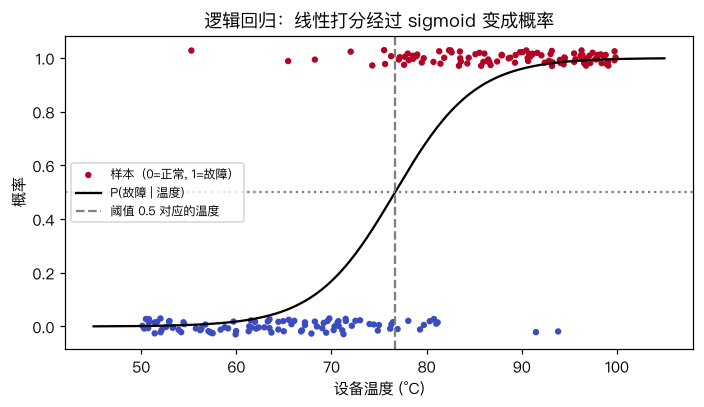
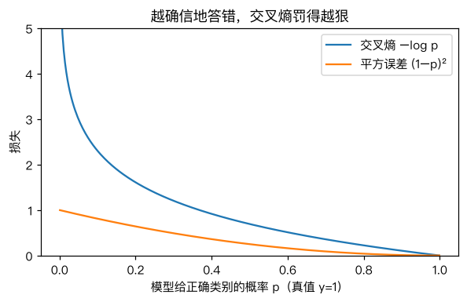

# 二分类问题：逻辑回归

> 对应原站：[二分类问题：逻辑回归](https://labuladong.online/zh/ai-coding/machine-learning/ml-logistic-regression/)（会员内容；本章为独立原创重写）

> **一句话结论**：逻辑回归 = 线性打分 + sigmoid 压成概率 + 交叉熵损失 + 梯度下降。它的梯度长得和线性回归几乎一样：「预测概率 − 真实标签」乘以特征。

## 预测「会不会」，不是预测「多少」

前几章预测的是配送时间，答案是一个连续的数。

现在换个问题：机房里每台设备每天报一次温度，要预测它当天会不会故障。答案只有两种：故障（1）或正常（0）。这叫二分类（binary classification）。

你可能会问：直接用线性回归预测 0 和 1，大于 0.5 算故障，不行吗？

能跑，但别扭。线性回归的输出没有上下界，温度很高时它会预测 1.7，温度很低时预测 -0.4。「故障的程度是 1.7」没有意义。我们真正想要的是一个**概率**：这台设备今天故障的可能性有多大。

## 先跑起来看看

数据是脚本生成的 200 台设备，温度 50~100°C，真实规律是 $P(\text{故障}) = \sigma(0.25(t - 75))$：

```text
❯ uv run python -m classic.ch08_logistic
手写   : w=0.2383 b=-18.2734
sklearn: w=0.2383 b=-18.2734
  60°C 故障概率  手写 0.018  sklearn 0.018
  75°C 故障概率  手写 0.401  sklearn 0.401
  85°C 故障概率  手写 0.879  sklearn 0.879
  95°C 故障概率  手写 0.987  sklearn 0.987
训练准确率 0.910，决策边界 t = 76.68°C
```

手写版和 sklearn 的 `LogisticRegression` 参数一致到小数点后四位。学到的 w=0.238 也接近真实的 0.25。



## 三步：打分、压缩、判断

```d2
direction: down
x: "温度 t"
z: "线性打分\nz = w·t + b"
s: "sigmoid\np = 1/(1+e^(−z))"
p: "P(故障) ∈ (0,1)"
d: "p ≥ 阈值?" {shape: diamond}
y1: "预测 1"
y0: "预测 0"
x -> z
z -> s
s -> p
p -> d
d -> y1: 是
d -> y0: 否
```

**第一步和线性回归完全一样**：算一个分数 $z = wx + b$。z 可以是任何实数，叫 logit。

**第二步用 sigmoid 函数把 z 压到 (0, 1)**：

$$\sigma(z) = \frac{1}{1+e^{-z}}$$

z 很大时 σ 趋近 1，很小时趋近 0，z=0 时正好 0.5。

**第三步按阈值判断**。默认 0.5，对应 z=0，也就是 $t = -b/w = 76.68°C$。这个温度就是决策边界（decision boundary）。阈值不一定是 0.5——要「宁可错报也不能漏报」时就调低，这是 [分类模型的评估](10-ml-classification-metrics.md) 的主题。

你可能会问：为什么非得是 sigmoid？

一个好理解的说法：sigmoid 的反函数是 $\log\frac{p}{1-p}$，即「对数几率」（log-odds）。逻辑回归其实是在说：**故障的对数几率随温度线性增长**。温度每升 1°C，故障几率乘以 $e^{0.238} \approx 1.27$。这个解释在业务上很好用：「温度每高 1 度，风险高 27%」。

## 为什么不用 MSE

有了概率，损失怎么定？最自然的想法是继续用平方误差 $(p - y)^2$。

问题出在「很确信地答错」的样本上。下面是同一个真实为 1 的样本，模型给的分数越来越离谱时，两种损失对 z 的梯度：

```text
  真值 y=1, 打分 z=-6, p=0.0025:  BCE 梯度 -0.9975   MSE 梯度 -0.0049
  真值 y=1, 打分 z=-2, p=0.1192:  BCE 梯度 -0.8808   MSE 梯度 -0.1850
  真值 y=1, 打分 z=+0, p=0.5000:  BCE 梯度 -0.5000   MSE 梯度 -0.2500
```

错得最离谱（z=-6）的时候，MSE 的梯度反而几乎是 0。因为 sigmoid 在两端是平的，MSE 的梯度要乘上 sigmoid 的导数 $p(1-p)$，在两端趋近 0。模型错得越狠，越学不动——这正好反了。

二元交叉熵（Binary Cross-Entropy，BCE）：

$$L = -\frac1n\sum\big[y_i\log p_i + (1-y_i)\log(1-p_i)\big]$$

说白了就是「给正确答案的概率取负对数」。给正确答案 0.99 的概率，损失 0.01；给 0.01，损失 4.6；给 0，损失无穷大。



更妙的是它和 sigmoid 合起来求导，所有麻烦项都消掉了：

$$\frac{\partial L}{\partial z_i} = p_i - y_i$$

就这么干净。于是

$$\nabla_w L = \frac1n X^\top(p - y)$$

和线性回归的 $\frac2n X^\top(\hat y - y)$ 几乎一模一样，只是 $\hat y$ 换成了 $p$。

回到主线：LLM 训练用的损失，就是这个交叉熵的多分类版——对词表里每个 token 算一个概率，损失是「正确的下一个 token 的概率取负对数」（[Softmax 回归](11-ml-softmax.md) 会讲多分类版本）。你在 API 账单上看到的 token，每一个在训练时都贡献过一份这样的 $-\log p$。

## 动手：和 sklearn 对到小数点后四位

完整代码 [`code/ml/classic/ch08_logistic.py`](../code/ml/classic/ch08_logistic.py)。训练循环：

```python
for _ in range(self.epochs):
    p = sigmoid(Z @ w + b)
    err = p - y                       # ∂BCE/∂z
    gw = Z.T @ err / n
    gb = err.mean()
    w = (w - self.lr * gw) / (1 + self.lr * pen)   # L2 正则做隐式一步
    b -= self.lr * gb
```

想和 sklearn 对上，有三个细节：

**1. sklearn 默认带 L2 正则。** `LogisticRegression(C=1.0)` 的目标函数是 $C\sum \text{BCE} + \frac12\|w\|^2$。这和「平均 BCE + $\frac{1}{2Cn}\|w\|^2$」只差一个正数倍，最优点相同。我在 sklearn 源码 `sklearn/linear_model/_logistic.py` 里核对过，它内部正是 `l2_reg_strength = 1.0 / (C * sw_sum)`。很多人手写的逻辑回归和 sklearn 对不上，就是忘了这一项。

**2. 标准化。** 温度在 50~100，直接跑 GD 会遇到上一章的窄谷问题。我们在内部标准化，训练完再把参数换算回原始尺度。注意正则项罚的是原始尺度的 w，换算到标准化空间后惩罚系数要除以 $\sigma^2$。

**3. sigmoid 的数值稳定。** $e^{-z}$ 在 z=-1000 时会溢出。代码里按 z 的正负分两支写。

测试覆盖一维和五维数据，五维时概率差在 1e-4 以内、预测完全一致：

```text
❯ uv run pytest -q classic/tests/test_ch08_logistic.py
...                                                                      [100%]
3 passed in 0.76s
```

## 它的边界是一条直线

逻辑回归在特征空间里画的边界是 $w^\top x + b = 0$，一维是一个点，二维是一条直线，高维是一个超平面。如果两类数据得用曲线才能分开，它就无能为力，除非你手动加特征（比如 $x^2$）。

这个局限在 [下一章](09-ml-logistic-regression-doodles.md) 会看得非常具体。

## 对照你的环境

你在 AI PR 审查平台上看到的每条 finding 都有个「置信度」，「是否强卡」本质就是对置信度设阈值的二分类。如果那个分数是模型直接吐出来的数字而不是校准过的概率，「0.8」并不一定意味着「80% 是真问题」——逻辑回归的好处恰恰是，用交叉熵训练出来的概率通常是比较校准的。

## 常见坑

- **忘了 sklearn 默认有正则**：手写的结果「差一点」，往往是这个原因。要无正则，sklearn 里设 `C=np.inf`。老教程里常见的 `penalty=None` 在 sklearn 1.8 已标记弃用、1.10 移除（本机 1.9.1 源码里的 deprecation 说明就是这么写的）。
- **用 MSE 训练分类器**：确信的错误学不动，见上文。
- **log(0)**：p 恰好为 0 或 1 时 BCE 是无穷大，计算前 clip 到 [1e-12, 1-1e-12]。
- **把 0.5 当成唯一阈值**：业务代价不对称时，阈值应该跟着调。
- **完全可分的数据**：没有正则时，w 会一直增大到无穷（sigmoid 越来越陡），GD 永不收敛。

## 练习

1. 去掉正则（`C=np.inf`），在 `device_data` 上训练，w 和 b 和有正则时差多少？再构造一个完全可分的数据集（温度 >75 全故障），观察无正则时 w 随迭代怎么变化。
2. 给模型加第二个特征「设备年龄」，生成数据时让年龄也影响故障概率，画出二维的决策边界直线。
3. （工程题）你们的 CI 想根据「改动行数、改动文件数、是否动了 lockfile、作者近 30 天 revert 次数」预测一个 PR 合入后会不会被 revert。用逻辑回归会遇到哪些特征工程问题（尺度、长尾、类别特征）？训练出来的 w 怎么向团队解释？

## 延伸阅读

- [sklearn LogisticRegression 文档](https://scikit-learn.org/stable/modules/linear_model.html#logistic-regression)（目标函数的精确写法）
- [sklearn/linear_model/_logistic.py](https://github.com/scikit-learn/scikit-learn/blob/main/sklearn/linear_model/_logistic.py)
- 下一章：[实战：逻辑回归识别涂鸦](09-ml-logistic-regression-doodles.md)
