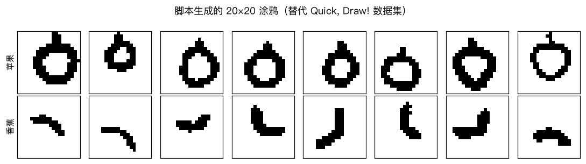
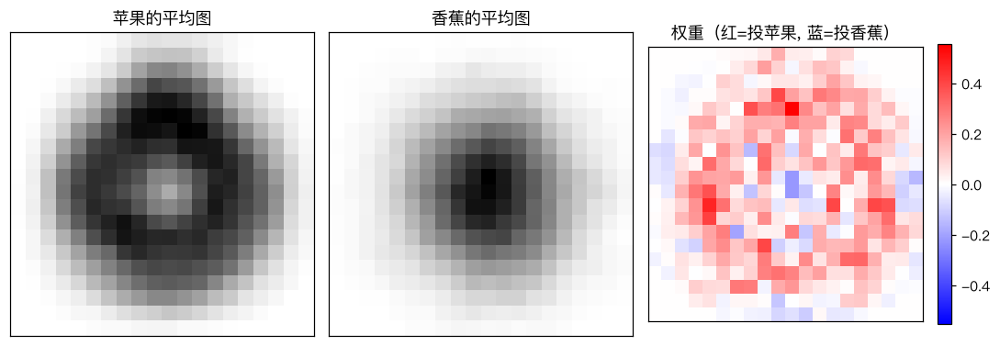
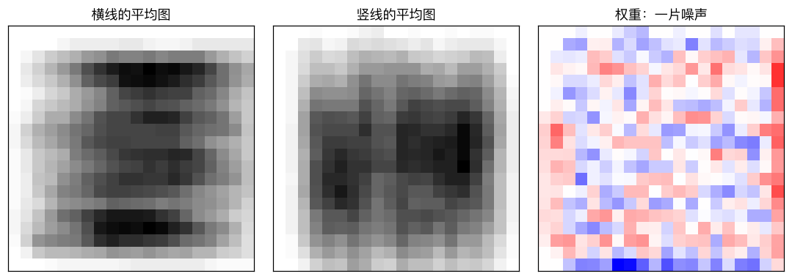
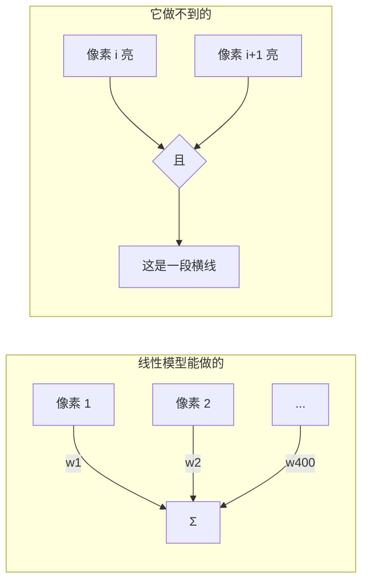

# 实战：逻辑回归识别涂鸦

> 对应原站：[实战：逻辑回归识别涂鸦](https://labuladong.online/zh/ai-coding/machine-learning/ml-logistic-regression-doodles/)（会员内容；本章为独立原创重写）

> **一句话结论**：把图片的每个像素当成一个特征，逻辑回归就能区分苹果和香蕉；它学到的权重可以画回成一张图，告诉你模型在看哪里。但它只能给每个像素位置一个固定权重，「由哪些像素组合成什么形状」这种事，它学不会。

## 图片也能喂给逻辑回归吗

[上一章](08-ml-logistic-regression.md) 的输入是一个温度。图片可是一个二维网格。

你可能会问：逻辑回归只认一个特征向量，图片怎么塞进去？

很简单：把 20×20 的图片一行接一行拉平，得到一个长度 400 的向量，每个分量是一个像素的值。在逻辑回归眼里，这就是一个有 400 个特征的样本。

## 数据：为什么不用 Quick, Draw!

这一章的原型是 Google 的 Quick, Draw! 数据集，玩家在 20 秒内画出的几千万张涂鸦。但它要从 Google Cloud 下载，单个类别的数据就有上百 MB，而本教程约定**不下载外部数据**。

所以我写了一个小生成器 [`ch09_doodles.py`](../code/ml/classic/ch09_doodles.py) 来「模拟手绘」：

- **苹果**：一个歪歪扭扭、不一定闭合的圆，顶上一根歪柄。
- **香蕉**：一段弯月形的弧，角度随机旋转。

每一笔都有随机的位置、大小、角度、手抖（几条低频正弦叠加）和笔触粗细，最后栅格化成 20×20 的黑白图：



和真实涂鸦比，这个数据「干净」得多（没有乱涂、没有画一半放弃的），所以下面的准确率会偏乐观。但对我们要讲的两件事——权重可视化和线性模型的局限——它完全够用，而且你可以随意改生成规则做实验。

## 先跑起来看看

```text
❯ uv run python -m classic.ch09_doodles
训练 800 张 / 测试 400 张, 特征数 400
测试准确率  手写 0.917   sklearn 0.917   两者预测一致率 1.000
横线 vs 竖线（位置随机）: 训练准确率 0.739  测试准确率 手写 0.585  sklearn 0.585
```

第一行：直接复用上一章的 `LogisticRegressionGD`，一行代码没改，测试准确率 91.7%，和 sklearn 逐张一致。

第二行先放着，后面解释。

## 权重画回成图

模型对一张图的打分是 $z = \sum_{i=1}^{400} w_i x_i + b$。每个像素位置 i 有一个权重 $w_i$：那个位置有墨水（$x_i = 1$）时，就给分数加上 $w_i$。

所以把 400 个权重重新排成 20×20，就能看出模型在每个位置「投谁的票」：



左边两张是两类样本的平均图。苹果是一个圈，中间空；香蕉的墨水集中在中间。

右边是权重：**红色的一圈**是「这里有墨水就更像苹果」，正中间偏蓝（或接近 0）是「这里有墨水更像香蕉」。模型学到的，大致就是「苹果平均图减去香蕉平均图」。

你可能会问：这是巧合吗？

不是。对逻辑回归这种线性模型，每个像素的贡献相互独立、直接相加，所以它能学到的最多就是「哪些位置的墨水对哪一类更有利」——一张模板。分类就是拿新图和这张模板做点积，看像苹果模板多一点，还是像香蕉模板多一点。

生活类比：像用一张镂空的模板卡去盖一幅画，数漏出来的红区墨水多还是蓝区墨水多。类比的局限在于，真正的模板卡是 0/1 的，而权重是连续的，越红的位置越「值钱」。

## 线性模型的天花板

现在回头看输出第二行。换一个任务：分辨**横线**和**竖线**，线的位置在画布上随机。

人类一眼就能分。逻辑回归只有 58.5%，比瞎猜好不了多少：



原因从平均图上一看就懂：横线出现在每一行的概率差不多，竖线出现在每一列的概率也差不多，两类的平均图**都是一团均匀的灰**。没有哪个像素位置「有墨水就更像横线」——一个像素有没有墨水，跟它属于横线还是竖线无关；有关的是**它和左右邻居是否同时有墨水**。

这是一个「组合」特征：像素 A 和像素 B 同时亮。线性模型只能把每个像素的贡献加起来，表达不了「同时」。训练准确率 73.9%、测试 58.5%，说明它连训练集都只能靠死记硬背若干个具体位置。



你可能会问：那怎么办？

两条路。一是人工设计特征，比如「每一行墨水的总和的最大值」，这对横竖线很有效，但每个新问题都得重新设计。二是让模型**自己学特征**：在逻辑回归前面再加几层，每层都能把下层的特征组合起来——这就是 [神经网络](../p6-nn-llm/01-ml-neural-network.md)。

回到主线：LLM 的最后一层其实就是一个巨大的「线性打分 + softmax」，和这里的逻辑回归同构；它之所以能理解语言，全靠前面几十层 Transformer 把 token 组合成了足够好的特征。线性层负责「投票」，前面的层负责「造出值得投票的特征」。

## 动手

训练入口：

```python
def train_doodle_model(seed=0, C=0.1, epochs=3000):
    X, y = make_doodles(seed=seed)
    Xtr, Xte, ytr, yte = split(X, y, 400)
    model = LogisticRegressionGD(C=C, lr=0.5, epochs=epochs, standardize=False).fit(Xtr, ytr)
    return model, (Xtr, Xte, ytr, yte)
```

两个选择说明一下：

- `standardize=False`：像素已经都在 [0, 1]，而且画布边角的像素几乎永远是 0，标准差接近 0，硬做标准化反而会把噪声放大。
- `C=0.1`：400 个特征、800 个样本，参数不少，正则强一点更稳。

测试断言了两件事：手写与 sklearn 的准确率差 ≤ 1%、概率差 ≤ 0.02；以及横竖线任务的准确率 < 70%（线性模型的天花板本身也是一个可回归的事实）：

```text
❯ uv run pytest -q classic/tests/test_ch09_doodles.py
..                                                                       [100%]
2 passed in 1.51s
```

## 对照你的环境

webapp 前端里很多「规则式」判断，例如按 className 或 DOM 位置判断一个元素是不是按钮，本质是给每个「位置/属性」一个固定权重；一旦布局换了，规则就失效，跟本章的横竖线一样。这也是为什么 chrome-devtools MCP 这类工具宁可给 Agent 一棵结构化的 a11y 树，而不是一张截图的像素：结构化特征让下游的判断更简单。

## 常见坑

- **期待它认得平移后的图**：权重绑死在像素位置上，把苹果整体往左挪 5 个像素，打分就变了。
- **对恒为 0 的像素做标准化**：除以接近 0 的标准差，数值爆炸。我们在 Softmax 那章就因此踩过一次发散（见 [Softmax 回归](11-ml-softmax.md) 代码注释）。
- **用合成数据得出过于乐观的结论**：生成器有多干净，准确率就有多虚高。换真实数据前别对外宣称数字。
- **只看准确率**：两类平衡时还好，下一章会看到类别失衡时准确率多么具有欺骗性。

## 练习

1. 把生成器里苹果的柄去掉，重新训练，权重图顶部会怎么变？准确率呢？
2. 为横竖线任务手工设计两个特征（比如「行墨水和的最大值」「列墨水和的最大值」），只用这两个特征训练逻辑回归，准确率能到多少？
3. （工程题）你想用逻辑回归给 CI 截图做「页面是否白屏」检测：把截图缩放到 32×32 灰度，每个像素一个特征。这个方案在哪些情况下会失效？哪些人工特征会比原始像素更稳？

## 延伸阅读

- [Quick, Draw! 数据集](https://github.com/googlecreativelab/quickdraw-dataset)（本章没有下载，仅供了解）
- Minsky & Papert, *Perceptrons*（1969）：线性模型无法表示 XOR 等组合关系的经典论证
- 下一章：[分类模型的评估](10-ml-classification-metrics.md)
