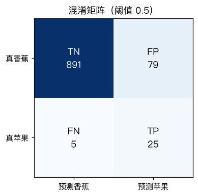
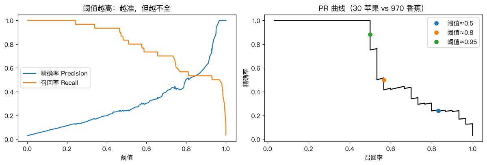

# 分类模型的评估

> 对应原站：[分类模型的评估](https://labuladong.online/zh/ai-coding/machine-learning/ml-classification-metrics/)（会员内容；本章为独立原创重写）

> **一句话结论**：某一类很少时，准确率会骗人。要用精确率（找出来的有多少是对的）和召回率（该找的找到了多少）分别衡量，两者此消彼长；调阈值就是在它们之间做取舍，而取舍的依据是业务代价，不是数学。

## 97% 准确率的模型，可能一个都没找到

[上一章](09-ml-logistic-regression-doodles.md) 的苹果/香蕉模型，在一半对一半的测试集上准确率 91.7%。

现在换一个更像真实工作的场景：一大堆涂鸦里绝大多数是香蕉，只混了 3% 的苹果，任务是把苹果挑出来。

你可能会问：准确率 91.7% 的模型，在这里表现应该也差不多吧？

先看一个「什么都不做」的模型：不管看到什么，都说是香蕉。它的准确率是 97%。比我们训练的模型还高。

但它一个苹果都没找到。

## 先跑起来看看

```text
❯ uv run python -m classic.ch10_metrics
测试集：苹果 30 张，香蕉 970 张
全猜香蕉               acc=0.970  P=0.000  R=0.000  F1=0.000  [TP=0 FP=0 FN=30 TN=970]
模型 阈值=0.5          acc=0.916  P=0.240  R=0.833  F1=0.373  [TP=25 FP=79 FN=5 TN=891]
模型 阈值=0.8          acc=0.971  P=0.515  R=0.567  F1=0.540  [TP=17 FP=16 FN=13 TN=954]
模型 阈值=0.95         acc=0.984  P=0.938  R=0.500  F1=0.652  [TP=15 FP=1 FN=15 TN=969]
ROC-AUC = 0.9676
```

同一个模型，换三个阈值，表现像是三个完全不同的模型。准确率只差几个百分点，P（精确率）从 0.24 变到 0.94。

## 混淆矩阵：四个格子

把「真实是什么」和「预测成什么」交叉，得到四种情况。约定「苹果」是正类（positive），也就是我们要找的东西：



| | 预测香蕉 | 预测苹果 |
|---|---|---|
| **真香蕉** | TN 真阴性 | FP 假阳性（误报） |
| **真苹果** | FN 假阴性（漏报） | TP 真阳性 |

阈值 0.5 时：找对了 25 个苹果（TP），漏了 5 个（FN），但把 79 根香蕉错当成了苹果（FP）。

准确率 = (TP+TN)/全部。它把四个格子混在一起，而 TN 有 891 个，淹没了一切。**类别失衡时，准确率主要在衡量「你认不认得多数类」**。

## 两个问题，两个指标

我们真正关心的是两个问题：

**找出来的里面，有多少是真的？** 这是精确率（precision）：

$$P = \frac{TP}{TP + FP}$$

阈值 0.5 时 P=25/104=0.24。你拿着模型挑出的 104 张去给人看，四张里只有一张是苹果。

**该找的里面，找到了多少？** 这是召回率（recall）：

$$R = \frac{TP}{TP + FN}$$

阈值 0.5 时 R=25/30=0.83。

生活类比：拿渔网捞鱼。网眼大（阈值高），捞上来的几乎全是鱼（精确率高），但小鱼漏掉了（召回率低）；网眼小，鱼都捞上来了，水草垃圾也一起上来了。这个类比不成立的地方是，渔网的网眼只有一个维度，而真实模型的「错误」往往集中在某些特定类型的样本上（比如画得特别小、或者没闭合的苹果）。调阈值只能整体放松或收紧，没法专门针对某一类错误——那得回去改模型或数据。

## 阈值：在 P 和 R 之间滑动

模型输出的是概率，阈值是我们自己定的：



左图：阈值越高，精确率越高、召回率越低。右图把它们画在一起，就是 PR 曲线（Precision-Recall curve）。

```d2
direction: right
a: "模型输出概率 p"
b: "p ≥ 阈值?" {shape: diamond}
c: "阈值低\nR↑ P↓\n宁可错报，不可漏报"
d: "阈值高\nP↑ R↓\n宁可漏报，不要打扰"
a -> b
b -> c
b -> d
```

你可能会问：那最好的阈值是多少？

数学上没有答案，取决于**一次漏报和一次误报各值多少钱**：

- 癌症筛查：漏报的代价是一条命，误报的代价是多做一次复查。阈值放低，追求召回。
- 垃圾邮件过滤：误报会让客户的重要邮件进垃圾箱，漏报只是多一封广告。阈值放高，追求精确。

我的观点：**一个分类模型上线前，最重要的产出不是 F1，而是一张「阈值 → (P, R)」的表格，交给业务方选**。工程师替业务方偷偷选了 0.5，是最常见的失职。

## 单一指标：F1 和 AUC

需要一个数来比较模型时，有两个常用选择。

**F1** 是 P 和 R 的调和平均：$F1 = \frac{2PR}{P+R}$。调和平均的特点是被短板拖累：P=1、R=0 时 F1=0。它仍然依赖于阈值。

**ROC-AUC** 与阈值无关。它的一个很好记的含义：**随机抽一个正样本和一个负样本，模型给正样本打分更高的概率**。我们的代码就是直接按这个定义算的：

```python
def roc_auc(y_true, scores):
    pos, neg = scores[y_true == 1], scores[y_true == 0]
    diff = pos[:, None] - neg[None, :]
    return float(np.mean((diff > 0) + 0.5 * (diff == 0)))
```

0.9676 说明模型的「排序能力」很强；P 只有 0.24，是因为负样本太多了，哪怕只有很小比例的香蕉排到了苹果前面，数量上也压倒了苹果。**AUC 高而 P 低，是类别极度失衡时的典型画面。** 这种时候 PR 曲线比 AUC 更诚实。

回到主线：评估 LLM / Agent 也逃不开这四个格子。一个「判断 PR 是否有 bug」的 Agent，报得越多召回越高、误报也越多；你调 system prompt 里「只报确定的问题」这类措辞，本质就是在挪阈值。

## 动手

完整代码 [`code/ml/classic/ch10_metrics.py`](../code/ml/classic/ch10_metrics.py)，PR 曲线的核心是排序 + 累加：

```python
def pr_curve(y_true, scores):
    order = np.argsort(-scores, kind="mergesort")
    s, y = scores[order], y_true[order]
    tp = np.cumsum(y)              # 阈值设在第 i 个分数时的 TP
    fp = np.cumsum(1 - y)
    last = np.r_[np.diff(s) != 0, True]   # 同分只在最后一个位置结算
    tp, fp, th = tp[last], fp[last], s[last]
    return tp / (tp + fp), tp / y.sum(), th
```

「同分只结算一次」是个容易忽略的细节：两个样本分数相同时，阈值不可能把它们分开。测试里我们故意把分数四舍五入到两位小数制造大量同分，再和 `sklearn.metrics.precision_recall_curve(drop_intermediate=False)` 逐点对照；P、R、F1、混淆矩阵、FPR、AUC 都对上了：

```text
❯ uv run pytest -q classic/tests/test_ch10_metrics.py
..                                                                       [100%]
2 passed in 0.52s
```

## 对照你的环境

你维护的 AI PR 自动审查平台，周报里本来就有「误报率」和「强卡」。对上这一章的语言：

- 一条 finding 被人工处置为「不是问题」，就是一个 FP；「误报率」通常指 FP/(TP+FP)，即 1 − 精确率。注意它**不是**统计学里的 FPR（FP/(FP+TN)），后者的分母是所有「没问题的代码」，根本数不清。两个词混用是团队沟通里很常见的误会。
- 「强卡」是一个更高的阈值：只有置信度足够高的 finding 才阻塞合并，用召回换精确率。
- 平台很难算召回率，因为「没被报出来的真 bug」（FN）要等线上出事才知道。这是代码审查类系统评估上的根本困难，值得在周报里明说。

## 常见坑

- **类别失衡时报准确率**：先算一下「全猜多数类」的准确率作为基线。
- **混淆「误报率」**：业务说的误报率多半是 1−精确率，统计学的 FPR 是另一回事，写清楚公式。
- **阈值在测试集上调**：阈值也是超参数，要在验证集上选。
- **只看 AUC**：极度失衡时 AUC 可以很好看而精确率惨不忍睹，配上 PR 曲线一起看。
- **忘了正类是谁**：precision/recall 都是针对「正类」算的，正类定反了，数字含义全变。

## 练习

1. 把苹果比例从 3% 改成 30%，重跑。阈值 0.5 下的 P 变了多少？说明精确率为什么对类别比例敏感，而召回率不敏感。
2. 实现一个函数：给定「每次漏报成本 c_fn、每次误报成本 c_fp」，在 `pr_curve` 的所有阈值里找出总成本最低的那个。c_fn=100、c_fp=1 时选出的阈值是多少？
3. （工程题）你们的一条告警规则是「5 分钟内 5xx 比例 > 2% 就电话告警」。过去一个月它响了 40 次，事后复盘只有 6 次是真故障；同期还有 2 次故障它没响。算出它的精确率、召回率；值班同学抱怨「误报太多」，你会怎么调，代价是什么？再想想：如果只能拿到「响了的那 40 次」的数据，你能算出召回率吗？

## 延伸阅读

- [sklearn: Precision-Recall](https://scikit-learn.org/stable/auto_examples/model_selection/plot_precision_recall.html)
- Saito & Rehmsmeier, [The Precision-Recall Plot Is More Informative than the ROC Plot When Evaluating Binary Classifiers on Imbalanced Datasets](https://journals.plos.org/plosone/article?id=10.1371/journal.pone.0118432)
- 下一章：[多分类问题：Softmax 回归](11-ml-softmax.md)
