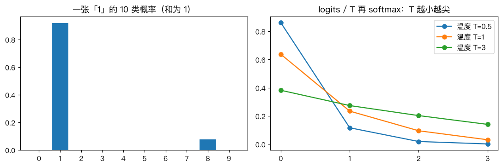
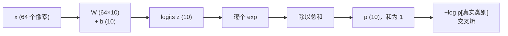
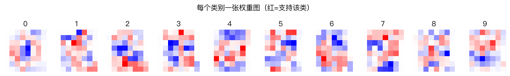

# 多分类问题：Softmax 回归

> 对应原站：[多分类问题：Softmax 回归](https://labuladong.online/zh/ai-coding/machine-learning/ml-softmax/)（会员内容；本章为独立原创重写）

> **一句话结论**：Softmax 回归是逻辑回归的多分类版：每个类别各算一个分数，用 softmax 变成和为 1 的概率，用交叉熵训练。只有两类时它就退化成 sigmoid。LLM 吐出每一个 token 前的最后一步，就是一次词表大小的 softmax。

## 不止两个选项的时候

[逻辑回归](08-ml-logistic-regression.md) 只回答一个是非题：是苹果还是香蕉。

可大多数分类问题都不止两类。手写数字有 0~9 十类；工单要分到前端、后端、运维、产品；LLM 要从十几万个 token 里选下一个。

你可能会问：用十个逻辑回归，每个回答「是不是数字 k」，取分数最高的，不就行了？

这叫一对多（one-vs-rest），确实能用。但十个模型各自独立训练，它们输出的十个「概率」加起来不等于 1，彼此也没法比较。我们想要的是一个模型直接给出一个**概率分布**：这张图是 0 的概率 2%，是 1 的概率 92%，是 8 的概率 6%……

## 先跑起来看看

```text
❯ uv run python -m classic.ch11_softmax
logits [2, 1, 0.1] -> softmax [[0.659  0.2424 0.0986]]
logits 都加 100     -> softmax [[0.659  0.2424 0.0986]]  (平移不变)
logits 都乘 3       -> softmax [[0.9495 0.0473 0.0032]]  (更尖：相当于温度降低)
digits 10 分类 测试准确率  手写 0.9685  sklearn 0.9704  概率最大差 1.08e-01
第 1 张测试图(真值 1) top-3: 1:0.921, 8:0.078, 4:0.001
```

数据是 sklearn 自带的 `load_digits`：1797 张 8×8 的手写数字，像素值 0~16。手写的 softmax 回归测试准确率 96.9%，sklearn 是 97.0%。



## 从分数到概率

每个类别 k 有自己的一组权重 $w_k$ 和偏置 $b_k$，各算一个分数：

$$z_k = w_k^\top x + b_k,\quad k = 0, 1, \dots, K-1$$

十个类就是十个分数，叫 logits。然后用 softmax 变成概率：

$$p_k = \frac{e^{z_k}}{\sum_j e^{z_j}}$$



指数保证每个概率都是正的，除以总和保证加起来是 1。指数还有一个效果：放大差距。上面的例子里分数是 2、1、0.1，差得不算多，概率却是 66%、24%、10%。

输出里还有两个性质，后面都会用到：

- **平移不变**：所有 logits 同时加 100，概率不变。因为 $e^{z+c}/\sum e^{z_j+c}$ 里的 $e^c$ 约掉了。
- **缩放改变尖锐程度**：所有 logits 乘以 3，最大的那个从 66% 涨到 95%。反过来，除以一个大于 1 的数，分布就变平。这个除数就是温度（temperature）。

你可能会问：两类时它和 sigmoid 是什么关系？

只有两类时，利用平移不变，把第 0 类的分数减到 0，第 1 类的分数是 $z$，那么 $p_1 = \frac{e^z}{1 + e^z} = \sigma(z)$。完全就是 sigmoid。测试 `test_softmax_two_classes_is_sigmoid` 在 33 个点上验证了这件事，误差 1e-12。

## 交叉熵与那个熟悉的梯度

损失仍然是「给正确答案的概率取负对数」，只是正确答案现在是 K 类中的一个：

$$L = -\frac1n\sum_i \log p_{i, y_i}$$

把真实标签写成 one-hot 向量 $Y$（真实类别处为 1，其余为 0），对 logits 求导，结果和逻辑回归一样干净：

$$\frac{\partial L}{\partial Z} = \frac{1}{n}(P - Y)$$

预测概率减去 one-hot，就是每个类别分数该往哪边调。正确类别的概率不到 1，它的分数要往上推；其他类别的概率不为 0，它们的分数要往下压。

回到主线：这一节几乎就是 LLM 训练损失的全部定义。把「10 个数字类别」换成「词表里的 10 万个 token」，把「64 个像素」换成「Transformer 最后一层的隐状态」，你就得到了语言模型的输出层和损失。你调 API 时设的 `temperature`，就是在 softmax 之前把 logits 除以 T：T<1 让模型更「确定」，T>1 让它更「发散」（详见 [LLM 是怎么预测下一个 token 的](../p0-core/04-llm-token-prediction.md)）。

## 动手：和 sklearn 对齐

完整代码 [`code/ml/classic/ch11_softmax.py`](../code/ml/classic/ch11_softmax.py)。softmax 本身有一个必做的数值技巧：

```python
def softmax(Z):
    Z = Z - Z.max(axis=1, keepdims=True)   # 平移不变 → 先减最大值，exp 不会溢出
    E = np.exp(Z)
    return E / E.sum(axis=1, keepdims=True)
```

不减最大值的话，logits 到 1000 时 `np.exp` 就是 inf，inf/inf 是 nan。

训练循环和逻辑回归几乎一字不差：

```python
for _ in range(self.epochs):
    P = softmax(Zx @ W + b)
    G = (P - Y) / n
    W = (W - self.lr * (Zx.T @ G)) / (1 + self.lr * pen)
    b -= self.lr * G.sum(0)
```

这里有个我实际踩到的坑：第一版用的是显式正则 `W -= lr * (grad + pen * W)`，在 digits 上直接发散成 nan。原因是 digits 的边角像素几乎恒为 0，标准差极小，换算到标准化空间后那几维的正则系数 `pen` 巨大，`lr * pen > 2` 就会来回放大。改成「隐式」一步（除以 `1 + lr*pen`）之后，无论 pen 多大都稳定。

正则约定和 [逻辑回归](08-ml-logistic-regression.md) 一样，与 sklearn `LogisticRegression(C=...)` 的目标函数相同（sklearn 新版本对多类默认就是 multinomial 损失，即 softmax）。对照结果：

- 4 类 make_blobs：概率与 sklearn 差 < 1e-4。
- digits：准确率差 0.2 个百分点，但概率最大差 0.108。3000 步 GD 在 64 维、强正则下还没完全收敛，而 sklearn 用的 L-BFGS 是二阶方法，收敛得更彻底。我在测试里只对 digits 断言「准确率差 ≤ 1%」，没有假装概率也对上了。

```text
❯ uv run pytest -q classic/tests/test_ch11_softmax.py
....                                                                     [100%]
4 passed in 1.22s
```

## 每个类别一张模板

和 [上一章涂鸦](09-ml-logistic-regression-doodles.md) 一样，权重可以画回成图，现在是每个类别一张：



0 最好认：一圈红、正中间蓝（中间有墨水就不像 0）。7 顶上一横偏红。其他几张就没那么直观了，一是 8×8 太粗糙，二是每张图表达的是「和其他 9 类相比，哪里有墨水对我更有利」，而不是这个数字本身长什么样。分类就是拿输入图和这 10 张模板各做一次点积，看谁最像。线性模型的天花板也一样存在：它只会「比模板」，不会「看形状」。

## 对照你的环境

你的 SessionStart hook 按 cwd 路由到不同的 guardrails 文件，是一个写死规则的多分类器。如果哪天想让模型自己判断「这次对话属于哪个项目/场景」，最直接的做法就是让 LLM 在一组固定选项里选一个——它内部做的，正是对这几个选项 token 的 softmax 比大小。

## 常见坑

- **不减最大值**：logits 一大就 nan。
- **对 softmax 输出再取 log 时数值下溢**：概率极小时 log(0)=-inf。框架里都有 `log_softmax` / `CrossEntropyLoss` 直接从 logits 算，别自己先 softmax 再 log。
- **把 softmax 概率当置信度**：它总会给出一个和为 1 的分布，哪怕输入是一张乱码图。概率高不代表模型「懂」。
- **温度理解反了**：T 越小越尖（越确定），T→0 等价于 argmax。
- **标签没有转成 0..K-1**：代码里用 `np.unique` + `searchsorted` 做映射，别直接拿原始标签当下标。

## 练习

1. 写一个 `log_softmax(Z)`，不经过 `softmax` 直接计算，验证它在 logits = [1000, 1001, 1002] 时不出 nan。
2. 用 digits 的训练集比较三种方案的测试准确率：softmax 回归、10 个一对多逻辑回归取最大、sklearn 的 `OneVsRestClassifier(LogisticRegression())`。
3. （工程题）你想给团队的工单自动分到「前端 / 后端 / 运维 / 产品」四类，并且「模型拿不准时转人工」。用 softmax 概率怎么定义「拿不准」？（最大概率小于阈值？前两名差距太小？熵太高？）各有什么优缺点，怎么用历史工单选阈值？

## 延伸阅读

- [CS231n: Softmax classifier](https://cs231n.github.io/linear-classify/#softmax)
- [PyTorch CrossEntropyLoss](https://pytorch.org/docs/stable/generated/torch.nn.CrossEntropyLoss.html)（输入是 logits，不是概率）
- 下一章：[K 近邻算法](12-ml-knn.md)
