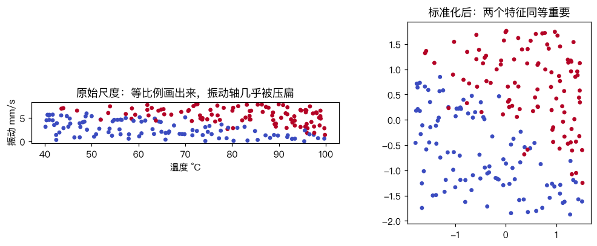
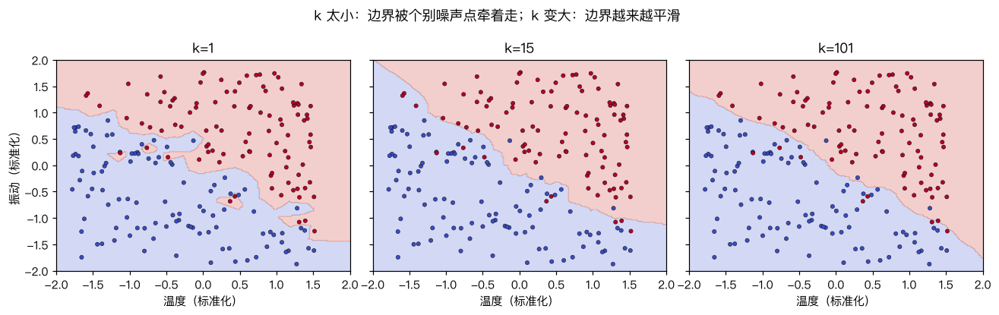

# K 近邻算法

> 对应原站：[K 近邻算法](https://labuladong.online/zh/ai-coding/machine-learning/ml-knn/)（会员内容；本章为独立原创重写）

> **一句话结论**：KNN 不训练任何参数，「训练」就是把数据存起来；预测时找出距离最近的 k 个历史样本，让它们投票。它的全部难点都在「距离」上：特征尺度、无关特征、维度和计算量。

## 不学公式，只翻旧账

[逻辑回归](08-ml-logistic-regression.md) 要先用梯度下降学出 w 和 b，再拿公式预测新设备。

换个思路：老师傅判断一台设备要不要检修，往往不是套公式，而是回忆「上次碰到温度这么高、振动这么大的机器，后来怎么样了」。

你可能会问：这也算机器学习？

算。这叫 K 近邻（K-Nearest Neighbors，KNN）：找到最像的 k 条历史记录，让它们的标签投票。k=3、三个邻居里两个需要检修，那就预测「需检修」。

它是「基于实例的学习」（instance-based learning）的代表：模型就是数据本身。

## 先跑起来看看

数据是脚本生成的设备记录，三个特征：温度（40~100°C）、振动（0~8 mm/s）、累计运行小时数（0~10000 h）。**是否需要检修只由温度和振动决定**，运行小时数是一列和标签无关、但数值大得多的特征——真实数据里这种列太常见了。

```text
❯ uv run python -m classic.ch12_knn
新设备 温度 78°C 振动 5.5mm/s 运行 3000h 的 3 个邻居(原始尺度):
  temp=74.7 vib=4.74 hours=2985 label=1 dist=15.3
  temp=60.7 vib=1.74 hours=2957 label=0 dist=46.6
  temp=61.9 vib=7.80 hours=2944 label=1 dist=58.7
  -> 投票结果 1
k   原始尺度acc  标准化后acc  sklearn(标准化)acc  只用温度+振动acc
1         0.530        0.870              0.870            0.820
3         0.470        0.900              0.900            0.910
5         0.480        0.920              0.920            0.900
15        0.370        0.900              0.900            0.910
51        0.430        0.850              0.850            0.900
```

先看邻居列表：找出来的三个「最像」的设备，温度差了 17°C、振动差了 4 mm/s，唯一真正接近的是运行小时数（都在 3000 左右）。投票结果碰巧是对的，但理由完全错了。

再看表格：原始尺度下准确率 37%~53%，**比抛硬币还差**；标准化之后跳到 85%~92%，和 sklearn 的 `KNeighborsClassifier` 每个预测都一致。

## 整个算法就是一张图


没有训练循环，没有损失函数，没有梯度。复杂度全部推迟到了预测时：每预测一个样本，都要和全部 n 个训练样本算一遍距离。

距离最常用欧氏距离 $\|a - b\| = \sqrt{\sum_j (a_j - b_j)^2}$。注意那个求和：**每个特征的差值平方直接相加**，谁的数值大，谁就主导了距离。

回到主线：KNN 是 RAG 检索的祖宗。[RAG 问答机器人](../p2-agent-basics/03-rag-qa-bot.md) 把文档切块、算 embedding，查询时找最近的 k 块塞进上下文——这就是 KNN，只不过「投票」换成了「把邻居原文交给 LLM 读」。它解决的是上下文有限的问题：不可能把整个知识库塞进 prompt，就只塞最相关的 k 条。这一章讲的每个坑（尺度、无关特征、k 的选择），在 RAG 里都换了个名字重新出现。

## 为什么尺度能毁掉一切

运行小时数的范围是 0~10000，温度是 40~100，振动是 0~8。两台设备温度差 20°C、振动差 4 mm/s，距离贡献是 $20^2 + 4^2 = 416$；运行小时数差 100 小时，贡献是 10000。后者是前者的 24 倍。

结果就是：**原始尺度下，KNN 实际上只按运行小时数找邻居**，而这一列和标签无关，所以准确率跟瞎猜差不多。

生活类比：比较两个人像不像，你用「身高（米）」和「年收入（元）」算距离。身高差 0.3 米只贡献 0.09，年收入差 1000 元贡献一百万，结果「像不像」完全由收入决定。

修复方式是标准化：每个特征减去训练集均值、除以训练集标准差，让每一列的典型波动都是 1。

```python
def standardize(Xtr, *others):
    mu, sd = Xtr.mean(0), Xtr.std(0)
    return [(Xtr - mu) / sd] + [(X - mu) / sd for X in others]
```



你可能会问：标准化之后，无关的运行小时数不还在距离里捣乱吗？

在。表格最后一列是只用温度和振动的结果：k 大时差距明显（k=51：0.90 vs 0.85），k 小时互有高低——测试集只有 100 条，差一两条就是 1~2 个百分点，别过度解读小差异。标准化让无关特征从「主导」降到「平等的噪声」，但没法让它消失。**KNN 没有任何机制判断哪个特征有用**——逻辑回归可以把无关特征的权重学成 0，KNN 只能靠你事先删掉它。

## k 怎么选



- **k=1**：边界被每一个噪声点牵着走，红区里能抠出一块块蓝色小岛。训练集准确率一定是 100%（每个点的最近邻就是它自己），典型的过拟合。
- **k 越大**：边界越平滑，噪声被平均掉了。
- **k 太大**：k=n 时所有预测都是多数类，欠拟合。

k 是超参数，用 [交叉验证](07-ml-overfitting.md) 来选。二分类时 k 取奇数可以避免平票。

## 动手

完整代码 [`code/ml/classic/ch12_knn.py`](../code/ml/classic/ch12_knn.py)。唯一值得说的技巧是距离的向量化：

$$\|a - b\|^2 = \|a\|^2 - 2a^\top b + \|b\|^2$$

```python
def pairwise_sq_dist(A, B):
    d = (A**2).sum(1)[:, None] - 2 * A @ B.T + (B**2).sum(1)[None, :]
    return np.maximum(d, 0)        # 浮点误差可能出现 -1e-12
```

一次矩阵乘法算完 m×n 个距离，比双重循环快几百倍。`np.maximum(d, 0)` 不是多余的：展开式在两个点几乎重合时会因为浮点相减得到一个极小的负数，再开根号就是 nan。

投票时用 `np.bincount` 数票、`argmax` 取最多的。平票时 `argmax` 返回编号最小的类别，这恰好和 sklearn 的规则一致，所以测试能断言「预测完全相同」而不只是「准确率接近」：

```text
❯ uv run pytest -q classic/tests/test_ch12_knn.py
...                                                                      [100%]
3 passed in 0.52s
```

## 对照你的环境

你的内部日志 CLI查日志时，常常要「找和这条报错最像的历史报错」。如果直接拿原始字段（时间戳毫秒数、状态码、路径长度……）算相似度，就会重演运行小时数那一幕：数值最大的时间戳主导一切。先想清楚哪些字段和「像不像」有关，再归一化。

## 常见坑

- **不标准化**：本章的头号问题，原始尺度可以让 KNN 退化到随机。
- **用全量数据算均值方差**：只能用训练集的，否则是数据泄漏。
- **无关特征**：KNN 不会自动忽略它们，要事先做特征选择。
- **高维**：维度一高，所有点之间的距离都差不多（维度灾难），「最近」失去意义。下一章的 64 维还行，几千维就要先降维。
- **预测太慢**：每次预测扫全量。数据大了要用 KD-Tree、Ball-Tree 或近似最近邻（ANN，比如 FAISS、HNSW）。

## 练习

1. 把 k=1 的模型在训练集上预测一遍，验证准确率是 100%。如果训练集里有两个特征完全相同但标签不同的样本，还是 100% 吗？
2. 实现距离加权投票：每个邻居的票数是 $1/d$。和等权投票比，在 k=51 时准确率有变化吗？
3. （工程题）你要给线上报错做「相似历史工单推荐」：每条报错有 service 名、HTTP 状态码、错误信息文本、发生时间。怎么把它们变成可以算距离的向量？哪些字段要丢掉、哪些要归一化、文本怎么处理？k 取多少合适？

## 延伸阅读

- [sklearn: Nearest Neighbors](https://scikit-learn.org/stable/modules/neighbors.html)
- [FAISS](https://github.com/facebookresearch/faiss)：大规模向量近邻检索
- 下一章：[实战：KNN 识别手写数字](13-ml-knn-digits.md)
