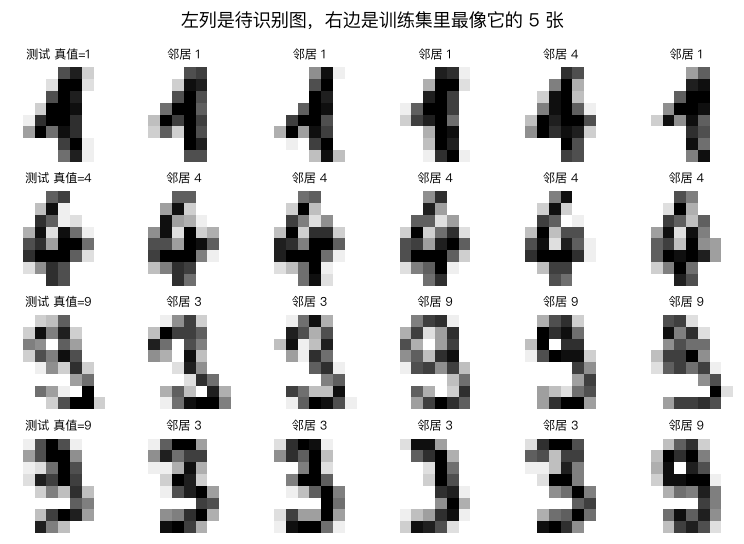
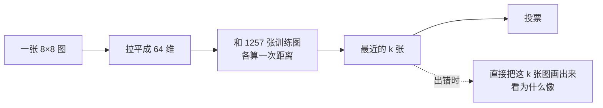
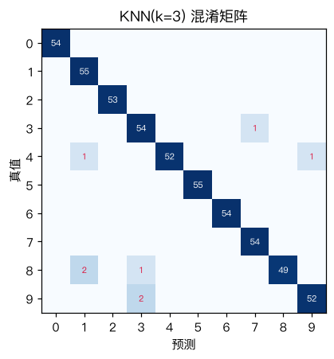

# 实战：KNN 识别手写数字

> 对应原站：[实战：KNN 识别手写数字](https://labuladong.online/zh/ai-coding/machine-learning/ml-knn-digits/)（会员内容；本章为独立原创重写）

> **一句话结论**：把 8×8 的图片拉平成 64 维向量，上一章那个二十行的 KNN 一行不改就能认手写数字，准确率 98%；它犯的错和「最近邻长什么样」直接相关，所以特别好调试。

## 换成图片还灵吗

[K 近邻算法](12-ml-knn.md) 用三个数（温度、振动、运行时长）描述一台设备。

你可能会问：一张手写数字的图，也能用「距离」衡量像不像吗？

能。8×8 的图有 64 个像素，每个像素一个灰度值，拉平就是一个 64 维向量。两张图的欧氏距离，就是对应像素差值的平方和开根号。两个人写的「3」，笔画大致落在同样的位置，距离就近；「3」和「7」笔画位置不同，距离就远。

这个想法朴素到让人怀疑。跑一下看看。

## 先跑起来看看

数据是 sklearn 自带的 `load_digits`：1797 张 8×8 灰度图，像素值 0~16，不用下载。按 7:3 分层切分：

```text
❯ uv run python -m classic.ch13_knn_digits
训练 (1257, 64)  测试 (540, 64)
k=1  手写 acc=0.9833 (26 ms)  sklearn acc=0.9833  预测完全一致=True
k=3  手写 acc=0.9852 (27 ms)  sklearn acc=0.9852  预测完全一致=True
k=5  手写 acc=0.9796 (25 ms)  sklearn acc=0.9796  预测完全一致=True
k=9  手写 acc=0.9741 (29 ms)  sklearn acc=0.9741  预测完全一致=True
k=15 手写 acc=0.9741 (32 ms)  sklearn acc=0.9741  预测完全一致=True
5 折交叉验证 k=1: 0.9857 ± 0.0041
5 折交叉验证 k=3: 0.9817 ± 0.0074
5 折交叉验证 k=5: 0.9857 ± 0.0041
最常见的错误: 把 8 认成 1，共 2 次；总错 8 / 540
```

`KNNClassifier` 就是上一章那个类，没改一行。540 张测试图错了 8 张，准确率 98.5%，比 [Softmax 回归](11-ml-softmax.md) 的 96.9% 还高。整个测试集的预测只花 26 毫秒。

几个观察：

- **这次没做标准化。** 64 个特征都是同一种东西（像素灰度），单位相同、范围相同（0~16），本来就可比。标准化反而会把几乎恒为 0 的边角像素放大成噪声。
- **k=1 就很好**，k 变大反而略降。数字类别之间分得很开，最近的那一个邻居已经足够可靠。
- **交叉验证里 k=1 和 k=5 打平，k=3 略低**，而在测试集上 k=3 最好。差距都在一个标准差之内——这就是「别在测试集上挑 k」的原因：在这个数据量下，k=1/3/5 根本分不出高下。

## 看看它的邻居

KNN 最大的优点是**可解释**：每一个预测都能追溯到具体的几张训练图。



前两行是预测对的：邻居长得和它几乎一样。后两行是 k=3 时预测错的两张「9」：

- 第三行最有意思。最近的两个邻居是 3，后面三个是 9。k=3 时 2:1 投给了 3，错；k=5 时 3:2 投给 9，对。这张 9 的上半圈没有闭合，在 8×8 下和 3 的上半部分确实很像。
- 第四行是一张写得很瘦、左侧几乎没有墨水的 9，五个邻居里四个是 3。说实话，这张图换人来认也得犹豫一下。

看邻居就知道为什么错——不是算法有 bug，而是那张图本身在像素空间里就离另一个数字更近。



你可能会问：逻辑回归和 softmax 不也能把权重画出来吗？

能，但那是一张「平均模板」，告诉你模型整体在看哪里；KNN 告诉你的是「这一次具体是因为像谁」。调试单个错误时，后者有用得多。

回到主线：这正是 RAG 比「把知识微调进模型」更受欢迎的原因之一。RAG 的回答可以溯源到检索出的那几段原文（就像这里的 5 个邻居），答错了能看出是检索错了还是生成错了；知识微调进参数之后，就只剩一个黑盒。

## 混淆矩阵



对角线是对的，红字是错的。错误很分散，最多的是「8 认成 1」，也只有 2 次。8 和 1 的混淆在 8×8 分辨率下不奇怪：一个写得瘦长的 8，中间那一竖的像素和 1 高度重合。

## 动手

完整代码 [`code/ml/classic/ch13_knn_digits.py`](../code/ml/classic/ch13_knn_digits.py)。混淆矩阵用 `np.add.at` 一行搞定：

```python
def confusion_matrix(y_true, y_pred, k=10):
    M = np.zeros((k, k), int)
    np.add.at(M, (y_true, y_pred), 1)   # 有重复下标时也能正确累加
    return M
```

为什么不直接写 `M[y_true, y_pred] += 1`？因为同一个 (真值, 预测) 组合出现多次时，花式索引的 `+=` 只会加一次。`np.add.at` 是「无缓冲」的累加，专门处理这种情况。

测试和 sklearn 对照预测结果与混淆矩阵。这里我留了一个口子：像素是整数，两张训练图到测试图的距离可能**完全相等**，并列时谁排前面取决于排序实现，所以断言的是「≥ 99.5% 一致」而不是「完全一致」。实际跑下来是 100% 一致，但这个容差是诚实的：

```text
❯ uv run pytest -q classic/tests/test_ch13_knn_digits.py
..                                                                       [100%]
2 passed in 0.66s
```

## KNN 的账单

这么好用，为什么没人拿 KNN 识别真实世界的图片？

**一是慢。** 预测一张图要和所有训练图比一遍。这里 1257 张训练图、64 维，26 毫秒。换成 MNIST（6 万张、784 维），计算量大约是这里的 580 倍；换成 ImageNet（上百万张、15 万维），就不现实了。

**二是像素距离很笨。** 把一个「3」整体往右挪 2 个像素，在人眼里它还是同一个 3，像素距离却可能变得很大，比和另一个「8」的距离还大。KNN 只会比「像素是否重合」，不会比「形状是否相同」。

解决方案和 [涂鸦那章](09-ml-logistic-regression-doodles.md) 一样：先用一个模型把图片变成更好的特征向量（embedding），再在 embedding 上做 KNN。这正是现在向量检索的标准做法——神经网络负责「把像不像变成距离近不近」，KNN 负责「找最近的」。

## 对照你的环境

你做 webapp 的 UI 像素对齐时，「截图逐像素 diff」就是本章的像素距离：按钮整体偏移 1px，diff 会亮一大片，但人眼觉得没区别；颜色差了一个色号，diff 很小，人眼却一眼看出来。所以 `ui-pixel-align` 那套「量 token、量间距」的做法，本质是先把截图变成「对人有意义的特征」，再比较。

## 常见坑

- **给同质特征做标准化**：像素已经同尺度，标准化会放大边角噪声。
- **在测试集上挑 k**：k=1/3/5 的差距在交叉验证的误差范围内，挑出来的「最优」只是噪声。
- **`M[i, j] += 1` 处理重复下标**：只会加一次，用 `np.add.at`。
- **期待它对平移、缩放鲁棒**：像素距离对这些变换非常敏感。
- **训练集一大就卡死**：m×n 的距离矩阵可能放不进内存，分块计算。

## 练习

1. 把测试图整体右移 1 个像素（`np.roll` 后把第一列置 0），重新预测，准确率掉了多少？
2. 数据增强：把每张训练图分别左右上下各平移 1 像素，训练集扩大到 5 倍，再测第 1 题的平移测试集。
3. （工程题）你想做一个「截图回归检测」：每次 CI 截一张页面图，找历史上最像的 5 张截图，如果最近邻距离突然变大就报警。像素距离会带来哪些误报？换成什么特征（DOM 结构哈希？感知哈希 pHash？视觉 embedding？）能降低误报，代价是什么？

## 延伸阅读

- [sklearn digits 数据集说明](https://scikit-learn.org/stable/datasets/toy_dataset.html#digits-dataset)
- [numpy.ufunc.at](https://numpy.org/doc/stable/reference/generated/numpy.ufunc.at.html)
- 下一章：[决策树：用一连串问题做分类](14-ml-decision-tree.md)
