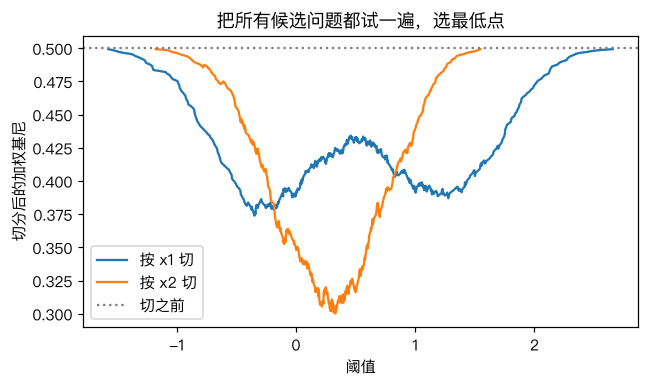
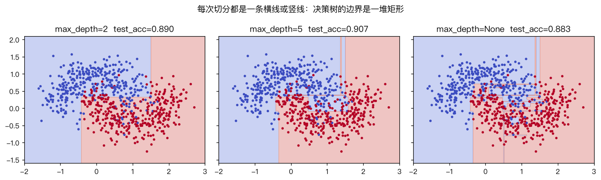

# 决策树：用一连串问题做分类

> 对应原站：[决策树：用一连串问题做分类](https://labuladong.online/zh/ai-coding/machine-learning/ml-decision-tree/)（会员内容；本章为独立原创重写）

> **一句话结论**：决策树也在最小化训练集上的损失（基尼不纯度），但它的「参数」是一串「某特征 ≤ 某阈值吗」的问题，没法求导。于是它把所有候选问题挨个试一遍，贪心地挑让不纯度下降最多的那个，然后对两边递归。

## 人做判断时不打分

[逻辑回归](08-ml-logistic-regression.md) 和 [Softmax](11-ml-softmax.md) 都是先给每个特征加权求和算一个分数，再看分数。

人不是这么做决定的。值班时收到告警，你脑子里过的是：「是 prod 吗？是 → 错误率超过 5% 了吗？超了 → 是刚发版吗？是 → 回滚。」每一步只看一个信息，答案决定下一步问什么。

你可能会问：能让机器自己学出这样一棵「问题树」吗？

能，这就是决策树（decision tree）。我们实现的是最经典的 CART（Classification And Regression Trees）算法，sklearn 的 `DecisionTreeClassifier` 用的也是它（优化过的版本）。

## 先跑起来看看

数据是 sklearn 的 `make_moons`：平面上 1000 个点组成两个交错的月牙，噪声 0.3，前 700 个训练、后 300 个测试。

```text
❯ uv run python -m classic.ch14_decision_tree
基尼不纯度: [5,5] -> 0.5  [9,1] -> 0.18  [10,0] -> 0.0
if x2 <= 0.330:  (gini=0.500, n=700)
  if x1 <= -0.418:  (gini=0.338, n=390)
    leaf counts=[41, 0] -> 0
  else:
    leaf counts=[43, 306] -> 1
else:
  if x1 <= 1.502:  (gini=0.253, n=310)
    leaf counts=[264, 22] -> 0
  else:
    leaf counts=[0, 24] -> 1
sklearn 根节点: x2 <= 0.330
max_depth  叶子数  train_acc  test_acc  sklearn_test_acc  预测一致率
1               2      0.814     0.820             0.820      1.000
2               4      0.907     0.890             0.890      1.000
4              10      0.913     0.890             0.890      1.000
6              24      0.939     0.893             0.893      1.000
10             51      0.974     0.880             0.880      1.000
None           72      1.000     0.883             0.880      0.997
```

深度 2 的树打印出来就是一段 if-else，可以直接贴进代码里用。根节点问的是「x2 ≤ 0.330 吗」，和 sklearn 选的完全一样。

限制深度时，手写和 sklearn 的预测 100% 一致；不限深度时 99.7% 一致，原因后面说。

## 损失：基尼不纯度

一个节点里的样本，如果全是同一类，就「纯」；两类各占一半，就最「杂」。基尼不纯度（Gini impurity）衡量的就是这个：

$$G = 1 - \sum_k p_k^2$$

$p_k$ 是节点里第 k 类的比例。[5, 5] 是 0.5，[9, 1] 是 0.18，[10, 0] 是 0。

它有个很好记的含义：**从节点里随机抽一个样本，再按节点里的类别比例随机给它贴个标签，贴错的概率**。全是一类时永远贴对，G=0。

一次切分把节点分成左右两个子节点，切分后的损失是两边不纯度按样本数加权平均：

$$G_{\text{split}} = \frac{n_L}{n}G_L + \frac{n_R}{n}G_R$$

## 训练：把每个问题都试一遍

「问题」的形式是：「特征 j ≤ 阈值 t 吗？」。j 有 d 种选择，t 只需要试相邻两个不同取值的中点（再细也不会改变划分结果）。所以候选问题是有限的，大约 d × n 个。

```d2
direction: down
a: "当前节点的样本"
b: "纯了？到最大深度？\n样本太少？" {shape: diamond}
l: "变成叶子\n记下各类数量"
c: "对每个特征 j：\n排序，试每个中点 t"
d: "选 G_split 最小的 (j, t)"
e: "G_split < G_当前?" {shape: diamond}
f: "左：x_j ≤ t"
g: "右：x_j > t"
a -> b
b -> l: 是
b -> c: 否
c -> d
d -> e
e -> l: 否
e -> f: 是
e -> g: 是
# 回边写成 a <- f，让 ELK 把 a 当起点排在最上面
a <- f
a <- g
```



这张图就是根节点的搜索过程：横轴是阈值，纵轴是切完后的加权基尼。按 x2 切（橙线）的最低点比按 x1 切更低，所以根节点问的是 x2。

你可能会问：为什么不用梯度下降？

因为「阈值 t 往右挪一点点」，只要没跨过某个样本，划分就不变，损失也不变；一跨过去，损失就跳一下。损失对 t 是阶梯函数，导数处处为 0 或不存在。没有坡，就没法下山，只能把每个台阶都试一遍。

还有一个更根本的问题：**贪心**。每一步只选「眼下最好的」切分，不考虑后面几层能不能切得更好。找全局最优的决策树是 NP 难问题，贪心是实际可行的妥协。这和 [局部最优](06-ml-local-global-optima.md) 是同一件事的另一种形态。

回到主线：决策树是「把判断过程写成可读规则」的极端。LLM 正好相反，判断过程藏在几十亿个参数里。Agent 工程里常见的做法是把两者组合：确定性强、需要审计的分支（权限、路由）用规则树写死，模糊的判断交给 LLM——你那套 hook + guardrails 就是这个结构。

## 动手：一次排序算完所有切点

完整代码 [`code/ml/classic/ch14_decision_tree.py`](../code/ml/classic/ch14_decision_tree.py)。朴素实现是对每个候选阈值都重新数一遍左右两边各类的数量，O(n²)。技巧是先排序，然后用累加和一次算出所有切点左边的类别计数：

```python
def best_split(X, y, k, features):
    n = len(y)
    best = None
    for f in features:
        order = np.argsort(X[:, f], kind="stable")
        xs, ys = X[order, f], y[order]
        left = np.cumsum(np.eye(k)[ys], axis=0)[:-1]   # 第 i 行 = 前 i+1 个样本的类别计数
        right = left[-1] + np.eye(k)[ys[-1]] - left
        nl = np.arange(1, n)
        w = (nl * gini(left) + (n - nl) * gini(right)) / n
        valid = xs[1:] > xs[:-1]                        # 相同取值之间不能切
        if not valid.any():
            continue
        w = np.where(valid, w, np.inf)
        i = int(np.argmin(w))
        if best is None or w[i] < best[0] - 1e-12:
            best = (float(w[i]), int(f), float((xs[i] + xs[i + 1]) / 2))
    return best
```

每个特征 O(n log n)。剩下的 `_grow` 就是一个普通的递归。

测试和 sklearn 对照了四件事：根节点的 (特征, 阈值)、深度 1~3 时的全部预测、叶子数、特征重要性（feature_importances_，即每个特征带来的加权不纯度下降之和，归一化）：

```text
❯ uv run pytest -q classic/tests/test_ch14_decision_tree.py
....                                                                     [100%]
4 passed in 0.54s
```

不限深度时为什么只有 99.7% 一致？树很深时，某些小节点里会出现两个切分的加权基尼**完全相等**。sklearn 每个节点会把特征随机打乱顺序再搜索（受 `random_state` 控制），并列时谁先被看到就选谁；我们固定按特征编号顺序。两边都是「最优」切分，只是选了不同的那个，在少数边缘点上预测不同。

## 深度：决策树的复杂度旋钮



每一次切分都是一条平行于坐标轴的线，所以决策树的边界是一堆矩形拼起来的阶梯。

- 深度 2：4 个矩形，大致分开了两个月牙。
- 深度 5：边界开始贴合月牙的弧形。
- 不限深度：72 个叶子，训练集 100% 正确，为每个噪声点都切了一个小方块。测试准确率反而从 0.893 掉到 0.883。

这是 [过拟合](07-ml-overfitting.md) 的又一个例子，只不过复杂度旋钮从「多项式次数」变成了「树的深度」。

## 对照你的环境

`inject-guardrails.sh` 按 cwd 路由到不同的护栏文件，就是一棵手写的决策树：「在公司仓库下吗？→ 是 webapp 吗？→ ……」。手写的好处是每条路径你都能解释。如果哪天想从历史 session 里「学」出这棵路由树（比如按 cwd、git remote、文件类型预测该注入哪些规则），决策树会是第一个值得试的模型，因为学出来的东西仍然能读成 if-else 并人工审核。

## 常见坑

- **不限深度**：训练集 100% 是危险信号，不是好消息。用 `max_depth`、`min_samples_leaf` 限制，或者用下一章的随机森林。
- **对数据太敏感**：训练数据稍微变一点，根节点就可能换一个特征，整棵树面目全非。
- **边界只能是轴对齐的**：数据真实边界是一条斜线时，决策树要用很多个小台阶去逼近。
- **以为决策树需要标准化**：不需要。它只比较「≤ 阈值」，单调变换不影响切分。
- **并列切分导致与 sklearn 不一致**：属于正常现象，不是 bug。

## 练习

1. 在 `make_moons` 上画出 `max_depth` 从 1 到 15 的训练/测试准确率曲线，找出测试准确率最高的深度。
2. 把基尼不纯度换成信息熵 $H = -\sum p_k \log_2 p_k$，和 sklearn 的 `criterion="entropy"` 对比根节点是否一致。
3. （工程题）你有过去一年的发布记录：改动文件数、是否改了数据库 migration、发布时间（是否周五）、是否经过 staging、作者是否新人，以及「是否引发线上事故」。训练一棵深度 3 的决策树，把它打印成 if-else，你会直接把它当发布门禁吗？它会犯哪些「数据少 + 贪心」带来的错误？

## 延伸阅读

- [sklearn: Decision Trees](https://scikit-learn.org/stable/modules/tree.html)（含复杂度分析和数学定义）
- Breiman et al., *Classification and Regression Trees*（1984）
- 下一章：[随机森林算法及实战](15-ml-random-forest.md)
