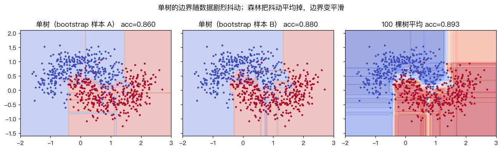
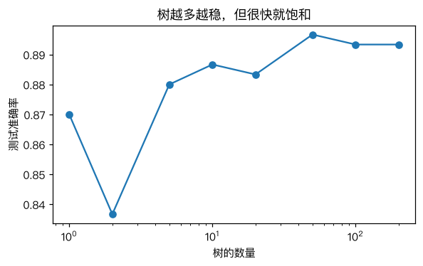

# 随机森林算法及实战

> 对应原站：[随机森林算法及实战](https://labuladong.online/zh/ai-coding/machine-learning/ml-random-forest/)（会员内容；本章为独立原创重写）

> **一句话结论**：随机森林用不同的 Bootstrap 样本训练很多棵完整的决策树，每个节点只在随机挑出的几个特征里找切分，预测时让所有树投票。单棵树随数据剧烈抖动，很多棵「抖法不同」的树平均下来，就又稳又准。

## 单棵树的两个毛病

[决策树](14-ml-decision-tree.md) 那章留下了两个问题。

一是深度难调。不限深度会过拟合，限得太浅又欠拟合。

二是对训练数据太敏感。你可能会问：敏感到什么程度？

我做了个实验：从同一份 700 个训练点里有放回地重抽 10 次，每次训练一棵不限深度的树，看它们在 300 个测试点上的预测：

```text
10 棵不限深度的单树: test_acc 0.853~0.893, 25.7% 的测试点至少有两棵树意见不同
```

准确率差了 4 个百分点，而且**四分之一的测试点**，换一份几乎一样的训练数据，预测就会翻转。

这种「方差大」的模型有一个好处：它的错误是随机的、东一个西一个。把很多个这样的模型平均起来，随机的部分就互相抵消了。

## 先跑起来看看

```text
❯ uv run python -m classic.ch15_random_forest
10 棵不限深度的单树: test_acc 0.853~0.893, 25.7% 的测试点至少有两棵树意见不同
森林   1 棵: 手写 test_acc=0.870  sklearn test_acc=0.863
森林  10 棵: 手写 test_acc=0.887  sklearn test_acc=0.893  OOB=0.877 / sklearn OOB=0.879
森林 100 棵: 手写 test_acc=0.893  sklearn test_acc=0.897  OOB=0.899 / sklearn OOB=0.897
digits: 单树 0.852  手写森林(50棵, 每节点 8/64 个特征) 0.963  sklearn 森林 0.969
```

（输出前面还有一行 sklearn 的 `UserWarning: Some inputs do not have OOB scores`，来自 10 棵树那次，后面「常见坑」里解释。）

月牙数据上效果不算夸张，因为它只有 2 个特征，单树已经不差了。真正说明问题的是最后一行：64 维的手写数字，单棵树 85.2%，50 棵树的森林 96.3%，涨了 11 个百分点。



左边两张是两棵用不同 bootstrap 样本训练的单树，边界都很碎，而且碎法不一样。右边是 100 棵树平均后的概率，边界平滑多了。

## 两种随机

「随机森林」这个名字里的随机，来自两个地方：

```d2
direction: down
d: "训练集 n 个样本"
b1: "Bootstrap 1\n有放回抽 n 个"
b2: "Bootstrap 2"
b3: "Bootstrap ..."
t1: "树 1\n每个节点随机挑 √d 个特征再找切分"
t2: "树 2"
t3: "树 ..."
v: "所有树的概率取平均"
y: "预测"
d -> b1
d -> b2
d -> b3
b1 -> t1
b2 -> t2
b3 -> t3
t1 -> v
t2 -> v
t3 -> v
v -> y
```

**第一种随机：Bootstrap 采样。** 从 n 个样本里**有放回地**抽 n 个。有的样本被抽到好几次，有的一次都没被抽到。每个样本没被抽中的概率是 $(1 - 1/n)^n \approx e^{-1} \approx 36.8\%$，所以每棵树大约只见过 63.2% 的不同样本。每棵树看到的数据不一样，长出来的样子就不一样。这一步叫 Bagging（Bootstrap AGGregatING）。

**第二种随机：每个节点只看部分特征。** 光有 Bagging 还不够。如果有一个特征特别强，每棵树的根节点都会选它，树和树之间还是很像，平均起来效果有限。随机森林在**每个节点**切分前，先随机挑 $\sqrt d$ 个特征（digits 是 $\sqrt{64} = 8$ 个），只在这几个里找最好的切分。这逼着树去用别的特征，树和树之间更不相关。

你可能会问：每次只看 8 个特征，单棵树不就变差了吗？

是的，单棵树会变差。但平均的效果取决于树与树之间的**相关性**：n 棵完全相同的树平均起来还是那一棵；n 棵各有各的错的树平均起来，错误就抵消了。随机森林是用「单树变差一点」换「树之间更不相关」，这笔账通常很划算。

生活类比：问一群专家同一个问题。如果他们读的是同一本教材、互相讨论过，十个人和一个人差不多；如果他们背景各异、独立作答，取多数意见就比任何一个人都可靠。类比的边界：专家投票时每个人都至少得比瞎猜强，随机森林也一样——如果每棵树都比瞎猜还差，投票只会让结果更差。

回到主线：这个「多个独立样本投票」的思路，在 LLM 时代有个直接的对应：自洽性（self-consistency）——同一个问题用较高温度采样多次，取出现最多的答案。它用更多 token 换可靠性，原理和随机森林一样：让错误彼此独立，再用投票抵消。

## 免费的验证集：OOB

每棵树都有大约 36.8% 的样本没见过，这些叫袋外样本（Out-Of-Bag，OOB）。对每个训练样本，只让**没见过它的那些树**投票，就得到了一个不需要额外切验证集的准确率估计。

输出里 100 棵树的 OOB 是 0.899，测试集准确率 0.893，非常接近。数据少、舍不得切验证集时，OOB 很好用。

## 动手

完整代码 [`code/ml/classic/ch15_random_forest.py`](../code/ml/classic/ch15_random_forest.py)。它直接复用上一章的 `DecisionTreeGini`，那里预留的 `max_features` 参数就是为这一章准备的：

```python
for _ in range(self.n_estimators):
    idx = rng.integers(0, n, n)                       # Bootstrap：有放回抽 n 个
    tree = DecisionTreeGini(max_depth=self.max_depth, max_features=mf,
                            random_state=int(rng.integers(1 << 31))).fit(X[idx], y[idx])
    tree.global_cols_ = np.searchsorted(self.classes_, tree.classes_)
    self.trees_.append(tree)
    if self.oob:
        out = np.setdiff1d(np.arange(n), idx)         # 这棵树没见过的样本
        P = np.zeros((len(out), len(self.classes_)))
        P[:, tree.global_cols_] = tree.predict_proba(X[out])
        oob_votes[out] += P
```

`global_cols_` 那一行处理了一个容易漏掉的边界情况：某个 bootstrap 样本可能恰好没抽到某个类别（digits 有 10 类时并不罕见），这棵树的 `classes_` 就只有 9 个，概率矩阵的列要映射回全局的 10 类。

投票方式和 sklearn 一致：不是数「每棵树投哪类」的硬票，而是**平均每棵树的概率**（软投票）。

我们的树每次随机挑特征，sklearn 内部的随机数流和我们不同，两边长出来的树不可能一模一样。所以测试断言的是统计意义上的一致：测试准确率差 ≤ 3%、OOB 差 ≤ 3%，以及森林不比单棵不剪枝的树差：

```text
❯ uv run pytest -q classic/tests/test_ch15_random_forest.py
..                                                                       [100%]
2 passed in 0.69s
```

## 树越多越好吗



树越多越稳，但很快就饱和（50 棵之后基本不动）。2 棵树那个低谷是个有意思的细节：两棵完全长开的树，叶子概率多半是 0 或 1，一旦意见相反就平票，`argmax` 一律判给类别 0，于是错得比 1 棵树还多。树多了，平票就几乎不会发生了。随机森林有个很好的性质：**加树不会过拟合**，只会让结果收敛到一个稳定值，代价只是算得更慢。所以实践中 n_estimators 不用调，给一个算力允许的数（几百）就行，要调的是 `max_features` 和 `min_samples_leaf`。

我的观点：在表格数据（每行一个样本、每列一个特征，比如你的日志统计、发布记录）上，随机森林和梯度提升树（XGBoost、LightGBM）至今仍是最值得先试的基线。它们不需要标准化、对异常值不敏感、几乎不用调参，往往比一个调得马马虎虎的神经网络好。

## 对照你的环境

你用的 `codex-cross-review` 就是一个两棵树的「森林」：Claude 和 Codex 两个异源模型各审一遍，共识 = 高置信，单边 = 存疑。它有效的前提和随机森林一样：**两个评审的错误要尽量不相关**。这也是为什么要用「异源」模型——同一个模型审两遍，相当于两棵用同样数据、同样特征长出来的树，投票几乎没有增益。

## 常见坑

- **树太少时 OOB 不可靠**：10 棵树时，有的样本恰好被每棵树都抽到过，没有任何树能给它 OOB 预测，sklearn 会发出 `Some inputs do not have OOB scores` 警告。我们的实现直接跳过这些样本。
- **以为森林能解释**：单棵树能打印成 if-else，几百棵树就不行了，只能看特征重要性。
- **特征重要性的偏差**：基于不纯度的重要性会偏向取值多的连续特征。更可靠的是置换重要性（permutation importance）。
- **内存和预测速度**：几百棵不剪枝的深树，模型文件可能有几百 MB，预测要遍历每棵树。
- **外推**：森林的预测不会超出训练数据中见过的范围，回归任务里尤其明显。

## 练习

1. 在 digits 上把 `max_features` 分别设为 1、8、64（64 等于纯 Bagging），比较测试准确率。为什么 64 反而不是最好的？
2. 用 OOB 预测选 `max_features`，和用 5 折交叉验证选的结果是否一致？哪个更快？
3. （工程题）你有一个月的 PR 审查数据：每条 AI finding 的规则类型、文件类型、diff 行数、模型置信度，以及人工处置结果（真问题 / 误报）。用随机森林预测「一条 finding 是否会被判为误报」，然后用特征重要性找出最容易误报的规则类型。这个结论在什么情况下会误导你？（提示：混杂变量、规则之间的相关性、样本量很少的规则。）

## 延伸阅读

- Breiman, [Random Forests](https://link.springer.com/article/10.1023/A:1010933404324)（2001）
- [sklearn: Ensemble methods](https://scikit-learn.org/stable/modules/ensemble.html)
- [sklearn: Permutation feature importance](https://scikit-learn.org/stable/modules/permutation_importance.html)
- 下一章：[K-Means 聚类算法](16-ml-kmeans.md)
