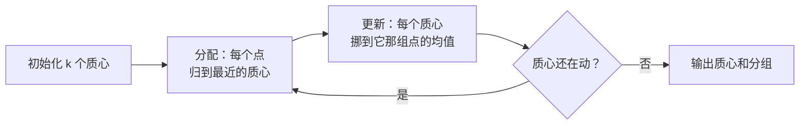
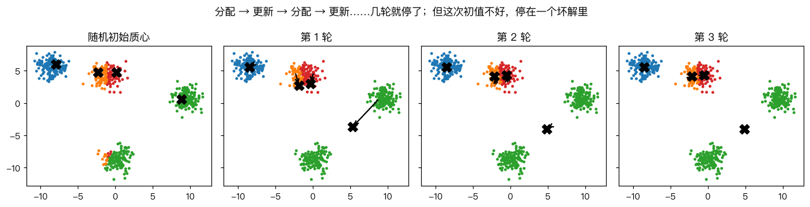
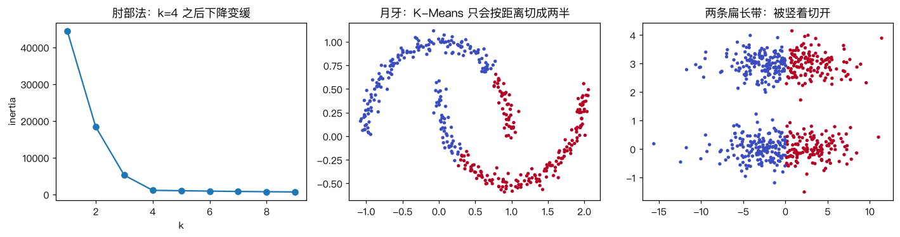

# K-Means 聚类算法

> 对应原站：[K-Means 聚类算法](https://labuladong.online/zh/ai-coding/machine-learning/ml-kmeans/)（会员内容；本章为独立原创重写）

> **一句话结论**：K-Means 不需要标签，只反复做两件事：「把每个样本分给最近的质心」和「把每个质心挪到它那组样本的均值」。每一步都让总误差不增，所以一定会停；但停在哪儿取决于初始质心，所以要多跑几次取最好的。

## 没有标签的时候

前面的模型都要标签：这台设备坏没坏、这张图是几。

可很多时候手里只有一堆数据，没有人标过。一万条报错日志，没人告诉你它们分几类；几千个用户的行为记录，没人告诉你有哪几种用户。

你可能会问：没有标准答案，机器能学什么？

能学「谁和谁像」。把相似的样本归到一组，组和组之间差别大——这叫聚类（clustering），属于无监督学习（unsupervised learning）。K-Means 是其中最简单、最常用的一个。

## 先跑起来看看

数据是 `make_blobs` 生成的 600 个点，真实情况是 4 团。我们把标签藏起来，只告诉算法「分成 4 组」：

```text
❯ uv run python -m classic.ch16_kmeans
手写 k-means++: 2 轮收敛, inertia=1127.40, 每轮 inertia: [1520.9, 1127.4] ...
sklearn 以手写结果为初值: inertia=1127.40
同一初值 X[0:4]: 手写 inertia=1127.4020  sklearn inertia=1127.4020
随机初始化(非 ++) 10 次各自的 inertia: [1127, 5134, 1127, 14149, 5134, 1127, 5134, 1127, 1127, 5141]
肘部法 k -> inertia: {1: 44493, 2: 18363, 3: 5241, 4: 1127, 5: 1023, 6: 916, 7: 821, 8: 750, 9: 683}
```

几个要点：

- 用 k-means++ 初始化，**两轮就收敛了**。
- 同一组初始质心，手写版和 sklearn 的 `KMeans(algorithm="lloyd")` 结果一致到小数点后四位。
- 如果用最朴素的随机初始化，10 次里只有 5 次找到了 1127 这个最好的解，其余停在 5134 甚至 14149。

inertia（惯性）是 K-Means 的损失：每个点到它所属质心的距离平方之和。越小说明每组越紧凑。

## 两步舞





这张图是一次**故意选得不好**的随机初始化：两个质心挤在上方中间那一团里，下方那团一个质心都没有。分配、更新、分配、更新，几轮后就停了——停在一个明显很差的结果里：上方中间那团被两个质心瓜分，右边和下方两团被一个质心「共享」，那个质心落在两团之间的空地上。

你可能会问：它为什么不自己纠正？

因为两步都只做局部改进。「分配」只是让每个点去找当前最近的质心；「更新」只是让质心去它那组的中心。没有任何一步会让一个质心「跳」到另一团去。这又是一次 [局部最优](06-ml-local-global-optima.md)。

## 为什么一定会停

这两步各自都在最小化同一个损失：

$$J = \sum_{i} \|x_i - \mu_{c_i}\|^2$$

- **分配步**：质心固定，每个点换到最近的质心，它自己那一项只会变小或不变。
- **更新步**：分组固定，一组点到某个位置的距离平方和，在这组点的**均值**处最小（这正是 [最小二乘](04-ml-least-squares.md) 里「最优直线过重心」的同一个事实）。

两步交替，J 单调不增；分组的可能方式是有限的，所以一定会在有限步内停下。测试 `test_inertia_never_increases` 断言的就是这件事。

生活类比：开奶茶店选址。先随便选 k 个店址，每个居民去最近的店（分配）；然后每家店搬到自己顾客的中心位置（更新）；顾客重新选最近的店……直到没人换店。类比的局限是：真实选址要考虑路网距离，而 K-Means 只认直线距离，且只能把店开在「均值」那个点，哪怕那里是一片湖。

回到主线：K-Means 是一种**压缩**：用 k 个质心代表 n 个点，每个点只需要记住「我属于第几组」。[上下文压缩](../p3-agent-internals/05-context-compaction.md) 是同一个思路在文本上的版本——用少量摘要代表大量对话，丢掉组内的细节，保留组和组的区别。下一章的颜色量化会把这个「压缩」看得非常直观。

## 初始化：k-means++

既然结果取决于初始质心，那就把初始质心选好一点。k-means++ 的想法是：**质心之间应该离得远**。

```python
def kmeans_pp_init(X, k, rng):
    centers = [X[rng.integers(len(X))]]               # 第一个随便挑
    for _ in range(1, k):
        d2 = pairwise_sq_dist(X, np.array(centers)).min(1)   # 每个点到最近已选质心的距离²
        centers.append(X[rng.choice(len(X), p=d2 / d2.sum())])  # 越远越可能被选中
    return np.array(centers)
```

离已有质心越远的点，越可能被选为下一个质心。这样 4 个初始质心大概率落在 4 个不同的团里。再配合「多跑几次取 inertia 最小的」（sklearn 的 `n_init`），就很稳了。

## k 选多少：肘部法

K-Means 要你先告诉它 k。可没有标签时，k 往往正是你想知道的东西。



左图是 inertia 随 k 的变化。k 越大 inertia 一定越小（k=n 时为 0），所以不能直接取最小。看曲线的「肘部」：k 从 3 到 4，inertia 从 5241 掉到 1127；从 4 到 5 只掉到 1023。再加质心收益很小了，k=4 就是肘部。

说实话，真实数据的肘部经常不明显。我的建议是：**别指望肘部法给出唯一答案，把 k 当成一个业务问题**——你希望日志分成几类才方便处理？

## 它的局限

中间和右边两张图是 K-Means 失败的样子：

- **月牙**：两个月牙交错在一起，K-Means 只会按「离哪个质心近」切成左右两半。它假设每一团是**凸的、球形的**。
- **两条扁长的带**：上下两条横带，K-Means 却竖着切开了。因为横带很长（x 方向标准差 4），竖着切能让每组的点离质心更近，inertia 更小。

这两个例子里，K-Means 的损失函数和「人眼看到的分组」根本是两回事。它不是没找到最优解，而是**最优解本身就不是我们想要的**。这时候要换算法（DBSCAN、谱聚类、高斯混合模型）或者先做特征变换。

## 动手

完整代码 [`code/ml/classic/ch16_kmeans.py`](../code/ml/classic/ch16_kmeans.py)。主循环：

```python
for it in range(1, max_iter + 1):
    D = pairwise_sq_dist(X, C)
    labels = D.argmin(1)                          # 分配
    newC = C.copy()
    for j in range(k):                            # 更新（空簇保持原位）
        m = labels == j
        if m.any():
            newC[j] = X[m].mean(0)
    shift = float(((newC - C) ** 2).sum())
    C = newC
    if shift <= tol:
        break
```

距离计算复用了 [KNN](12-ml-knn.md) 那章的 `pairwise_sq_dist`。测试用三组不同的初始质心，断言手写版与 sklearn 的质心（1e-8）、标签、inertia 完全一致，并检查 `best_of` 能恢复出真实的 4 团（ARI > 0.95）：

```text
❯ uv run pytest -q classic/tests/test_ch16_kmeans.py
...                                                                      [100%]
3 passed in 0.61s
```

## 对照你的环境

你用 内部日志 CLI 查日志时，经常面对几千条报错，一条条看不现实。一个实用的流程是：把每条报错的 message 去掉数字、ID、时间戳（变成模板），转成向量（TF-IDF 或 embedding），再 K-Means 分成 20~50 组，每组只看离质心最近的那条。这把「读几千条」压缩成「读几十条代表」，和本章说的压缩是同一件事。

## 常见坑

- **不标准化**：和 KNN 一样，距离会被数值大的特征主导。
- **只跑一次**：结果取决于初始化，至少用 k-means++ 加多次运行。
- **空簇**：某个质心一个点都没分到。我们的实现让它原地不动，sklearn 会把它重新放到离现有质心最远的点上。
- **对非球形的团用 K-Means**：月牙、环形、长条，它都会切错。
- **把聚类结果当成「真相」**：聚类只是某种损失函数下的最优分组，换一个 k、换一种特征，结果就完全不同。

## 练习

1. 在 `make_blobs` 上把 `cluster_std` 从 1.0 逐步加到 4.0，观察肘部是不是越来越不明显。
2. 实现 sklearn 的空簇处理：当某个簇为空时，把它的质心设为「离自己所属质心最远的那个点」。
3. （工程题）给你一周的应用日志（每行一条报错 message），用 K-Means 做日志聚类：写出从原始文本到向量的预处理步骤（去掉哪些变量、怎么分词、用 TF-IDF 还是 embedding），怎么选 k，以及怎么把每个簇自动命名成一句人能看懂的话（提示：可以把离质心最近的几条交给 LLM 总结——这一步要注意上下文长度）。

## 延伸阅读

- Arthur & Vassilvitskii, [k-means++: The Advantages of Careful Seeding](https://theory.stanford.edu/~sergei/papers/kMeansPP-soda.pdf)
- [sklearn: Clustering](https://scikit-learn.org/stable/modules/clustering.html)（各种聚类算法在不同形状数据上的对比图）
- 下一章：[实战：K-Means 颜色量化](17-ml-kmeans-color-quantization.md)
