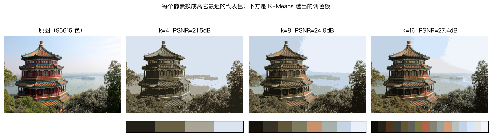
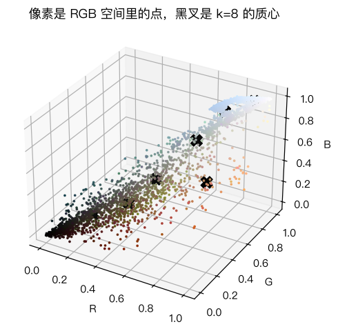

# 实战：K-Means 颜色量化

> 对应原站：[实战：K-Means 颜色量化](https://labuladong.online/zh/ai-coding/machine-learning/ml-kmeans-color-quantization/)（会员内容；本章为独立原创重写）

> **一句话结论**：把每个像素的 RGB 当成三维空间里的一个点做 K-Means，k 个质心就是 k 种代表色；每个像素换成离它最近的代表色，就能用极少的颜色重建图片。这是「用 k 个原型代表 n 个样本」最直观的样子。

## 只许用 8 种颜色

一张普通照片里有几万种颜色，但大多数彼此非常接近：一片天空是几百种略有差别的浅蓝，一片树叶是几百种深浅不同的绿。

如果只允许用 8 种颜色重画这张照片，并且尽量像原图，你会选哪 8 种？每个像素又该换成哪一种？

你可能会问：这和聚类有什么关系？

关系很直接。「选 8 种代表色」就是「把所有像素分成 8 组，每组派一个代表」；「每个像素换成哪种」就是「每个点属于哪个质心」。这正是 [K-Means](16-ml-kmeans.md) 在做的事。

GIF 只支持 256 色调色板、早期游戏机和电子墨水屏只有十几种颜色，它们都需要这个操作，叫颜色量化（color quantization）。

## 先跑起来看看

图片用 sklearn 自带的 `china.jpg`（颐和园佛香阁），`load_sample_image` 直接读，不用下载：

```text
❯ uv run python -m classic.ch17_color_quant
原图 640×427，273280 个像素，96615 种不同颜色
k=4    25 轮 0.02s  PSNR=21.54 dB  每像素 2 bit, 体积约为原来的 8.3%
k=8    47 轮 0.03s  PSNR=24.88 dB  每像素 3 bit, 体积约为原来的 12.5%
k=16   60 轮 0.05s  PSNR=27.40 dB  每像素 4 bit, 体积约为原来的 16.7%
k=32   35 轮 0.07s  PSNR=29.96 dB  每像素 5 bit, 体积约为原来的 20.8%
k=8 同初值对照: 手写 inertia=98.1663  sklearn inertia=98.1663  质心最大差 2.8e-14
```



原图 9.6 万种颜色，16 种颜色重建后，建筑的红柱、绿瓦、天空、树木都还认得出来；8 种时天空已经出现明显的色带；4 种时只剩下「暗、中、亮、天空」四档，画面变成了版画风格。每张图下方的色条就是 K-Means 选出的调色板，按亮度从暗到亮排列。

## 像素是空间里的点

```d2
direction: down
a: "图片 427×640×3"
b: "reshape 成 273280×3\n每行一个像素的 (R,G,B)"
c: "随机抽 1 万个像素"
d: "K-Means(k)\n得到 k 个质心 = 调色板"
e: "全部像素找最近质心\n得到 273280 个编号"
f: "编号查调色板\nreshape 回 427×640×3"
a -> b
b -> c
c -> d
b -> e
d -> e
e -> f
```

把 RGB 的三个通道当作 x、y、z 坐标，每个像素就是一个立方体里的点：



像素并不是均匀散在立方体里的。天空的像素挤在浅蓝色一角，树木挤在暗绿色一角，屋顶的红色是细细的一条。K-Means 会把质心放在点最密集的地方，所以调色板天然偏向「图里用得多的颜色」。

这也解释了一个现象：k=8 时，鲜艳的红柱子被一个偏橙的土红色代替了。红色像素在整张图里占比很小，为了它们单独留一个质心，换不来多少 inertia 的下降，K-Means 就把它们并进了附近的暖色组。**K-Means 优化的是全部像素的总误差，不是「重要的颜色」**。

回到主线：这一章就是「用很小的代价近似一个很大的东西」。LLM 里有完全对应的技术：模型量化（quantization）把 16 位浮点权重压到 4 位甚至更低，其中向量量化一派（例如 AQLM）几乎就是本章的做法：把权重切成小向量，用一个学出来的码本（codebook）里的代表向量近似每一个。量化让大模型塞进更小的显存，代价是精度损失——和这里 PSNR 下降是同一个交易。

## 动手

完整代码 [`code/ml/classic/ch17_color_quant.py`](../code/ml/classic/ch17_color_quant.py)，核心十行：

```python
def quantize(img_pixels, k, n_sample=10000, seed=0):
    rng = np.random.default_rng(seed)
    sample = img_pixels[rng.choice(len(img_pixels), n_sample, replace=False)]
    C, _, _, it, _ = kmeans(sample, k, seed=seed)             # 只在采样上聚类
    labels = np.concatenate([pairwise_sq_dist(chunk, C).argmin(1)
                             for chunk in np.array_split(img_pixels, 20)])   # 分块映射全部像素
    return C, labels, it
```

两个工程上的选择：

**只在 1 万个采样像素上聚类。** 27 万个像素里大量是重复或极相似的颜色，抽 1 万个（全量的 1/27）已经足够代表分布，聚类的计算量按比例下降，调色板几乎不变。这是处理大数据时最常用的一招：在样本上学模型，在全量上用模型。

**分块算距离。** 27 万 × k 的距离矩阵，k=32 时是 870 万个 float64，约 70 MB。不大，但分成 20 块就几乎不占内存了，换成 4K 图片也不会爆。

你可能会问：怎么衡量「重建得像不像」？

用 PSNR（Peak Signal-to-Noise Ratio，峰值信噪比）：$10\log_{10}(1/\text{MSE})$，像素值在 [0,1] 时。它就是 MSE 换成了对数刻度，越高越好。粗略经验：30 dB 以上肉眼很难看出差别，20 dB 左右能明显看出失真。上面的输出里，k 每翻一倍，PSNR 涨 2.5~3.3 dB。

体积那一列按「每像素存一个 $\lceil\log_2 k\rceil$ 位的编号 + 一张调色板」计算，没算熵编码。16 色时约为原图的 1/6。

测试在 5000 个采样像素上用同一组初值对照 sklearn，质心差在 1e-6 以内；并断言 k=2、8、32 的 PSNR 单调上升：

```text
❯ uv run pytest -q classic/tests/test_ch17_color_quant.py
..                                                                       [100%]
2 passed in 0.67s
```

## RGB 不是人眼的空间

我的观点：这一章最值得记住的不是代码，而是一个局限。

我们在 RGB 空间里算欧氏距离，但人眼对颜色差异的感知并不是 RGB 的欧氏距离。比如人眼对绿色的细微差别比对蓝色敏感得多。RGB 距离相同的两对颜色，一对可能看起来几乎一样，另一对却差很多。

更讲究的做法是先把像素转到 CIELAB 这类「感知均匀」的颜色空间再聚类，那里的欧氏距离更接近人眼的感受。这其实是 [KNN](12-ml-knn.md) 那章「距离怎么定义决定一切」的又一个例子。

## 对照你的环境

webapp 的设计 token 体系做的其实是人工版的颜色量化：设计师把界面里成百上千种「差不多的灰」收敛成一组有限的 token（`gray-100`…`gray-900`），代码里禁止裸 hex。如果你想审计一个老页面「到底用了多少种颜色、哪些可以合并到现有 token」，这一章的代码改一行就能用：把截图的像素聚类，再把每个质心映射到最近的 token。

## 常见坑

- **在全部像素上直接聚类**：大图会非常慢，先采样。
- **一次性算全量距离矩阵**：大图和大 k 时内存爆掉，分块。
- **以为 K-Means 会保留小面积的鲜艳色**：它只管总误差，小面积颜色容易被合并。
- **用 RGB 距离代表人眼感知**：转到 Lab 空间效果更好。
- **忘记归一化像素**：uint8 的 0~255 直接相减可能溢出（numpy 里 uint8 减法会回绕），先转 float。

## 练习

1. 把颜色空间换成 Lab（`skimage.color.rgb2lab`，需要 `uv add scikit-image`，或者自己按公式实现），在 Lab 空间里聚类 k=8，和 RGB 空间的结果并排比较。
2. 对 `flower.jpg`（sklearn 另一张自带图）做同样的实验。哪张图在 k=8 时 PSNR 更高？为什么？
3. （工程题）你要给 webapp 做一次「颜色债务」审计：对 50 个页面截图，找出所有实际渲染出的颜色，判断哪些是设计 token、哪些是「差一点点」的野生颜色。用本章的方法设计流程：怎么采样像素、k 怎么选、怎么判定某个质心「足够接近」某个 token（RGB 距离还是 Lab 的 ΔE）、抗锯齿和阴影产生的过渡色怎么排除。

## 延伸阅读

- [sklearn 示例：Color Quantization using K-Means](https://scikit-learn.org/stable/auto_examples/cluster/plot_color_quantization.html)
- [sklearn.datasets.load_sample_image](https://scikit-learn.org/stable/modules/generated/sklearn.datasets.load_sample_image.html)
- [CIELAB 色彩空间（维基百科）](https://en.wikipedia.org/wiki/CIELAB_color_space)
- 下一章：[模拟退火算法](18-ml-simulated-annealing.md)
