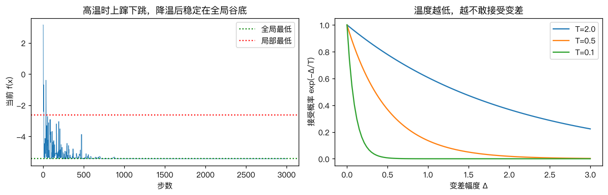
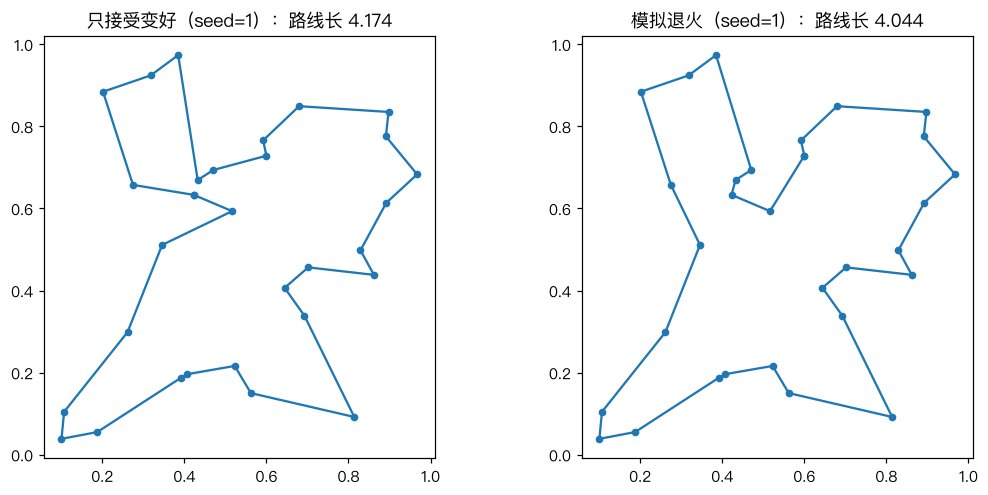

# 模拟退火算法

> 对应原站：[模拟退火算法](https://labuladong.online/zh/ai-coding/machine-learning/ml-simulated-annealing/)（会员内容；本章为独立原创重写）

> **一句话结论**：模拟退火每步随机试一个邻近的解，变好就接受，变差也以 $e^{-\Delta/T}$ 的概率接受；温度 T 从高到低慢慢降，前期敢于「往上走」跳出局部最优，后期稳定下来。它只需要能算损失，不需要梯度，所以连「排列」「路线」这种离散问题都能用。

## 被困住了怎么办

[局部最优与全局最优](06-ml-local-global-optima.md) 那章，梯度下降从 x=2 出发，停在了浅谷 x≈1.35，离全局最优 x≈-1.47 隔着一座小山。

当时提到了三种办法：多起点、加噪声、允许往上走。

你可能会问：「允许往上走」听起来很奇怪——优化不就是要往下吗？

想象你在一片丘陵里找最低的那个山谷，但只能看到脚下。如果你严格只往下走，第一个遇到的小坑就是你的终点。如果你偶尔愿意往上爬一段，就有机会翻过山梁，看到另一边更深的谷。

问题是：什么时候该往上爬？爬多少？

## 先跑起来看看

```text
❯ uv run python -m classic.ch18_simulated_annealing
GD     起点 +2.0 -> x=+1.3470 f=-2.6186  (局部最优)
退火   起点 +2.0 -> x=-1.4730 f=-5.4442  (接受过 130 次变差)
只接受变好 起点 +2.0 -> x=+1.3468 f=-2.6186
scipy dual_annealing -> x=-1.4730 f=-5.4442   网格全局最优 x=-1.4730
20 个随机种子里退火找到全局最优: 20 次
TSP 9 城: 初始 4.1269  只接受变好 2.8182  退火 2.8030  暴力枚举 8!=40320 条 -> 2.8030
TSP 30 城 只接受变好  5 次: [4.159, 4.174, 4.044, 4.368, 4.159]  平均 4.181
TSP 30 城 退火     5 次: [4.159, 4.044, 4.044, 4.044, 4.044]  平均 4.067
```

同样从 x=2 出发：

- 梯度下降停在局部最优。
- 「只接受变好」的随机搜索（每步随机跳一下，变好才接受）也停在局部最优。
- 模拟退火到了全局最优，途中接受过 130 次「变差」的移动。换 20 个随机种子，20 次都成功。

后面三行是一个完全不同的问题：旅行商问题（TSP），后面细说。

## 一个只看损失的循环

```d2
direction: down
a: "当前解 x，温度 T"
b: "随机生成邻居 x'"
c: "Δ = f(x') − f(x)"
d: "Δ ≤ 0？" {shape: diamond}
e: "接受 x ← x'"
f: "随机数 < e^(−Δ/T)？" {shape: diamond}
g: "留在 x"
h: "T ← α·T 降温"
a -> b
b -> c
c -> d
d -> e: "变好了"
d -> f: "变差了"
f -> e: 是
f -> g: 否
e -> h
g -> h
# 回边写成 a <- h，让 ELK 把 a 当起点排在最上面
a <- h
```

核心是那个接受概率 $e^{-\Delta/T}$，叫 Metropolis 准则：



右图把它画出来了：

- **Δ 越大（变差越多），越不容易接受。** 小小的变差常常被接受，大幅变差很少被接受。
- **T 越高，越容易接受。** T=2 时，变差 1 也有 60% 的概率被接受；T=0.1 时，几乎不可能。

左图是退火过程中 f(x) 的轨迹。前几百步温度高，f 上蹿下跳，好几次跳到了比局部最低（红线）还高的位置——那就是在翻山梁；500 步之后温度降到 $2 \times 0.995^{500} \approx 0.16$，大的变差基本不再被接受，轨迹稳定在全局谷底 -5.44。

名字来自冶金：把金属加热到高温，原子剧烈运动、可以随意重新排列；然后慢慢冷却，原子逐渐落到能量最低的晶格位置。冷却太快（淬火），原子来不及排好就被冻住了，材料又脆又硬——对应算法里降温太快，停在局部最优。这个类比在一个地方不成立：物理退火的温度是真实的物理量，算法里的 T 只是一个和损失同量纲的超参数，要按问题的损失尺度来设。

你可能会问：为什么不一直保持高温？

那就成了随机游走，永远不会稳定下来。高温负责探索（exploration），低温负责收敛（exploitation），降温就是从探索平滑过渡到收敛。

回到主线：LLM 采样里的 temperature 和这里的 T 是同一个数学形状。softmax 在 logits 上除以 T，等价于按 $e^{z/T}$ 加权：T 高，概率较低的 token 也常被选中（探索、更发散）；T 低，几乎总是选最大的那个（收敛、更确定）。Agent 做开放性任务（头脑风暴、找多种方案）时调高温度，做确定性任务（写代码、抽取字段）时调低，就是在做本章的取舍。

## 动手：通用的退火

完整代码 [`code/ml/classic/ch18_simulated_annealing.py`](../code/ml/classic/ch18_simulated_annealing.py)。我把它写成和问题无关的形式：只要你给一个 `loss` 和一个 `neighbor`：

```python
def anneal(loss, x0, neighbor, T0=2.0, alpha=0.995, steps=5000, seed=0):
    rng = np.random.default_rng(seed)
    x, fx = x0, loss(x0)
    best, fbest = x, fx
    T = T0
    for _ in range(steps):
        cand = neighbor(x, rng, T)
        fc = loss(cand)
        delta = fc - fx
        if delta <= 0 or rng.random() < np.exp(-delta / T):
            x, fx = cand, fc
            if fx < fbest:
                best, fbest = x, fx       # 记住见过的最好解
        T *= alpha                        # 指数降温
    return best, fbest
```

说穿了就是一个循环加一个 `if`。比梯度下降还短。

有两个细节：

- **记住「见过的最好解」**。因为会接受变差，最后一步的 x 不一定是途中最好的。
- **「只接受变好」就是 T→0 的特例**。代码里的 `greedy_descent` 就是把 T0 设成 1e-12 调同一个函数。

sklearn 里没有模拟退火（它不是一个「从数据学模型」的算法，而是一个通用优化器），所以这一章的对照对象换成了 scipy 的 `dual_annealing`（scipy 是 sklearn 的依赖，环境里已经有了），以及暴力网格和暴力枚举给出的标准答案。

## 没有梯度的问题：旅行商

退火真正的用武之地，是梯度根本不存在的问题。

旅行商问题（Traveling Salesman Problem，TSP）：给 n 个城市，找一条经过每个城市恰好一次、最后回到起点的最短路线。「解」是一个排列，排列没法求导。

用退火只需要定义两样东西：

```python
def tour_length(tour, D):                 # 损失：路线总长
    return float(D[tour, np.roll(tour, -1)].sum())

def two_opt(tour, rng, T):                # 邻居：随机翻转一段路线
    i, j = sorted(rng.choice(len(tour), 2, replace=False))
    new = tour.copy()
    new[i : j + 1] = new[i : j + 1][::-1]
    return new
```

「翻转一段」叫 2-opt 移动：相当于拆掉路线上的两条边，换成另外两条，能消掉路线里的一个交叉。

**9 个城市**时可以暴力枚举（固定起点后 8! = 40320 种路线），最短 2.8030。退火找到了完全相同的长度，只接受变好的贪心停在 2.8182。

**30 个城市**时，排列数是 29!/2 ≈ 4.4×10³⁰，暴力不可能。各跑 5 次：贪心平均 4.181，5 次里只有 1 次到 4.044；退火 5 次里 4 次到了 4.044。



图里两边用的是同一个随机种子（seed=1）：贪心停在 4.174，退火到了 4.044。两条路线的大轮廓差不多，差别集中在左上角那一片：贪心在那里先往下再折回中间，退火则把左上的几个城市串成了一条更顺的弧。要从左边的走法变成右边的走法，多半要经过几次「暂时变长」的 2-opt 翻转，而贪心从定义上就不接受这样的中间状态。贪心卡在了「任何一次 2-opt 翻转都会让路线变长」的局部最优，而退火在高温时接受过一些暂时变长的翻转，最后走到了更短的结构。

我的观点：退火的优点是通用（只要能算损失、能定义邻居），缺点是**慢且超参数敏感**（T0、降温速度、步数都要试）。有梯度的问题永远优先用梯度下降；有专门算法的问题（TSP 有 Concorde、LKH）优先用专门算法；退火适合「问题奇形怪状、没人专门研究过、你又只想要一个足够好的解」的时候。

## 测试

测试断言三件事：从 x=2 出发能到全局最优（并与 `dual_annealing` 的最优值一致）；T→0 且步长小时会被困住；9 城 TSP 与暴力枚举的最短长度完全相等：

```text
❯ uv run pytest -q classic/tests/test_ch18_simulated_annealing.py
...                                                                      [100%]
3 passed in 0.38s
```

## 对照你的环境

排 oncall 轮值、排 webapp 发布火车的车次、给几十个 E2E 用例分配到几台 CI 机器上让总时长最短——这些都是「解是一个排列或分配、损失能算、没有梯度」的问题。规模小时暴力，规模大时，一个 30 行的退火往往就能给出比手排好得多的结果。邻居函数可以定义为「交换两个人的班次」或「把一个用例挪到另一台机器」。

## 常见坑

- **T0 和损失尺度不匹配**：损失变化的典型量级是 1000，T0 设成 1，等于一开始就是贪心。经验做法是让初始接受「变差」的概率在 50%~80%。
- **降温太快**：α 太小，相当于淬火，跳不出局部最优。
- **只返回最后一步**：会接受变差，最后的解不一定是最好的，要单独记 best。
- **邻居定义太大或太小**：太小（步长 0.05）根本跨不过山梁，见测试 `test_zero_temperature_is_greedy_and_gets_stuck`；太大就变成了纯随机搜索。
- **用它解有梯度的问题**：神经网络有几十亿参数，退火每次只动一点点，比梯度下降慢到不可用。

## 练习

1. 把 `alpha` 从 0.995 改成 0.95 和 0.9999（相应调整步数），统计 20 个种子里找到全局最优的次数。
2. 实现「重启」：每当连续 500 步没有改进，就把温度重新升回 T0。在 30 城 TSP 上和不重启的版本比较。
3. （工程题）你们有 40 个 E2E 测试用例，每个用例的耗时已知（来自历史 CI 记录），要分到 6 台 CI 机器上并行跑，目标是让「最慢那台机器的总耗时」最短。用 `anneal` 写出 loss 和 neighbor；再和「按耗时从大到小，每次分给当前最空闲的机器」的贪心规则比较。思考：真实 CI 里用例耗时有波动，你的优化目标应该怎么改？

## 延伸阅读

- Kirkpatrick, Gelatt & Vecchi, [Optimization by Simulated Annealing](https://www.science.org/doi/10.1126/science.220.4598.671)（Science, 1983）
- [scipy.optimize.dual_annealing](https://docs.scipy.org/doc/scipy/reference/generated/scipy.optimize.dual_annealing.html)
- 下一部分：[手写神经网络：让模型自己学会特征](../p6-nn-llm/01-ml-neural-network.md)
