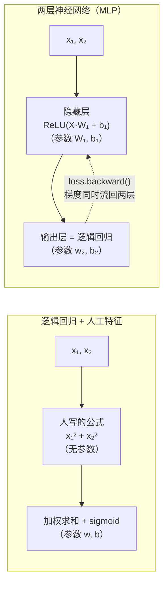

# 手写神经网络：让模型自己学会特征

> 原文（免费）：[手写神经网络：让模型自己学会特征](https://labuladong.online/zh/ai-coding/machine-learning/ml-neural-network/) —— 建议先读原文，本页是我的笔记

**一句话结论**：线性模型只学「怎么给特征加权」，特征得人来设计；神经网络把「算特征」这一步也做成带参数、可训练的隐藏层，而 ReLU 这样的激活函数是让它不退化回线性模型的关键。

## 核心要点

1. **问题设定**：两圈同心点（内圈半径 ≤ 0.5、外圈 1–1.5）做二分类。只用坐标 `(x₁, x₂)` 的逻辑回归，决策边界 `w·x + b = 0` 永远是直线，而内圈被外圈包住，任何直线都切不开——准确率不到一半。
2. **人工加一个特征就解决了**：加上 `x₁² + x₂²`（离原点距离的平方），同一份训练代码立刻 100%，边界变成半径约 0.79 的圆。
3. **「线性模型」看的是参数，不是输入**：`x₁² + x₂²` 在训练前就能从数据直接算出，没有可学参数，所以加了它的模型依然是线性模型。判定标准：分数对**参数**是不是线性的。
4. **难点在找特征**：两条螺旋缠在一起时，写不出一个漂亮公式；多项式特征能凑（5 次以内 20 项，测试 97.5%），但输入一到 784 维（涂鸦像素）就组合爆炸。
5. **神经网络的思路**：把「第 1 步算特征」也带上参数：`F = ReLU(X W₁ + b₁)`，再做和逻辑回归一样的第 2 步 `z = F w₂ + b₂`。**输出层本身就是一个逻辑回归**，只是它吃的特征是隐藏层学出来的；反过来，逻辑回归就是没有隐藏层的神经网络。
6. **ReLU = max(0, z)**：每个神经元在平面上是「一半平地、一半斜坡」，折痕位置和朝向由它的权重、偏置决定。训练好的 3 个神经元各自学成「这个点在某个方向上有多靠外」，加起来就近似了「离原点有多远」——和人工特征表达的是同一件事，但没人告诉它。
7. **为什么必须有激活函数**：去掉 ReLU，`(X W₁ + b₁) w₂ + b₂` 可以合并成 `X w + b`，不管叠多少层都塌缩成一个线性模型。原文用代码验证：准确率和普通逻辑回归一模一样。
8. **隐藏层权重必须随机初始化**：全 0 时所有神经元梯度相同、更新后仍相同，3 个神经元等于 1 个（对称性问题）。输出层可以从 0 开始。
9. **用 `nn.Sequential` 搭结构**：`Linear(2, 64) → ReLU → Linear(64, 64) → ReLU → Linear(64, 1)`，共 4417 个参数；`Linear` 就是全连接层，由它叠起来的网络就是多层感知机（MLP）。人只决定结构（多少层、每层多少神经元），每个神经元学成什么交给训练。



### 📝 作者是怎么讲的

- **先用旧武器失败，再引出新武器。** 不先讲神经网络，而是拿上一篇的逻辑回归硬上内外圈数据：准确率 48.8%，「还不如随手乱猜」。读者先体会到痛点，新方法才显得必要。借用：介绍一个新工具或机制，先展示现有方案在一个真实案例上怎么失败。
- **把失败解释到根上，再手动修好。** 追问「为什么效果这么差？」，推出决策边界只能是直线；接着观察数据，人工加入「距离平方」这个特征，准确率变成 100%，边界变成一个圆。这一步让读者确信：问题出在特征，不在训练。
- **用一个反直觉的澄清纠正误解。** 加了平方项的模型看起来不是线性的，作者专门停下来说明：判断线性看的是分数和参数的关系，不是和原始输入的关系。主动拆掉一个读者大概率会有的误解，比只讲正确结论更有价值。
- **一路加难度，直到人工方案撑不住。** 内外圈能靠人想出特征；换成双螺旋，「阁下又该如何应对？」；多项式特征能凑出 97.5%，但到了 784 维的涂鸦就会爆炸。问题链的终点自然落到「能不能让模型自己学特征？」
- **新结构写成旧结构的「一处改动」。** 神经网络被讲成「把加了特征的逻辑回归的第 1 步也带上参数」，并把两个模型的分数公式并排对比，形式完全一样，只是加权求和的对象从人设计的特征换成了学出来的 `h`。这就是 STYLE 里说的「朴实无华」：说穿了只是多了一层可训练的特征。
- **对照实验收尾。** 去掉 ReLU 再跑一遍，模型退化回线性，用实验结果说明激活函数的作用，而不是只给定义。

## 回到主线

原文结尾点了一句，我认为是全章最重要的话：这种「前面学特征、最后加权打分」的结构会一直出现，LLM 最后一步「从词表里预测下一个词，做的就是 softmax 回归」，前面的整个网络都在为这一步学特征。

把它接到主线上：**LLM 的隐藏层就是在把上下文（前面所有 token）加工成「对预测下一个 token 有用的特征」**。上下文给得越准、越相关，隐藏层能提炼出的特征就越有用；塞进一堆无关内容，等于往特征里灌噪声。Agent 的上下文工程（Skills 按需加载、Sub Agent 隔离、压缩）都是在「给这台特征提取器喂什么」上下功夫。

## 对照你的环境

在 `/Users/me/agent-learn/code/ml`（torch 2.14.1）用原文同样的数据生成方式和超参（3 个神经元、lr=1.0、3000 步、`manual_seed(0)`），在**全部 400 个点**上对比「有 ReLU」和「把 ReLU 换成恒等函数」（脚本放在 scratchpad，没写进 `code/`），真实输出：

```text
ReLU     acc=1.000 loss=0.0014
identity acc=0.570 loss=0.6899
params 4417
```

- 有 ReLU：100%，和原文一致（原文报的是训练集损失 0.0015，这里是全量 400 点，数字略有差异属正常）。
- 无 ReLU：损失卡在 `−log 0.5 ≈ 0.693` 附近，几乎什么都没学到——验证了「塌缩回线性模型」。
- 两个隐藏层各 64 个神经元的 Sequential 参数量确实是 `2·64+64 + 64·64+64 + 64+1 = 4417`。

另一个联系点：你给 Claude Code 写 skill 时做的是「人工特征工程」——把领域知识写成固定文本塞进上下文；模型内部的隐藏层做的是「学出来的特征」。两者分工正好对应本章的对比：模型能自己学的（通用语言能力）别写，模型学不到的（你们团队的 webapp 约定、平台上的项目名）才值得写进 skill。

## 自测题

1. 给逻辑回归加上特征 `x₁²`、`x₂²`、`x₁x₂`，它还是线性模型吗？神经网络为什么不是？
2. 一个隐藏层用 3 个神经元、激活函数换成 `lambda z: 2 * z`，能分开同心圆吗？
3. 把隐藏层权重 `W₁` 初始化为全 0、输出层随机初始化，会发生什么？

<details>
<summary>参考答案</summary>

1. 还是线性模型：这些特征训练前就能直接算出、不含参数，分数对 `w, b` 依旧是线性的。神经网络的隐藏层参数 `W₁, b₁` 被包在 ReLU 里，分数对它们不是线性的。
2. 不能。`2z` 仍是线性函数，整个网络依旧能合并成 `X w + b`，边界仍是直线。激活函数必须是非线性的（ReLU 的那道折痕就是非线性来源）。
3. 若 `b₁` 也像原文那样从 0 开始，每个神经元的线性分数恒为 0；PyTorch 规定 ReLU 在 0 处的梯度是 0（本机实测 `torch.relu(zeros).sum().backward()` 得 `tensor([0., 0., 0.])`），于是 `W₁, b₁` 永远收不到梯度，隐藏层输出恒为 0，模型只剩一个常数 `b₂`。即便偏置不为 0，各神经元的 `W₁` 列也只会沿同一方向（按 `w₂` 的比例缩放）更新，无法分化出不同的特征。结论同原文：隐藏层要随机初始化来打破对称性。

</details>

## 相关章节

- 前置：[Tensor 的常用操作](../p5-ml/01-pytorch-basics.md)、[什么是拟合](../p5-ml/03-ml-fitting.md)、[逻辑回归](../p5-ml/08-ml-logistic-regression.md)、[Softmax 回归](../p5-ml/11-ml-softmax.md)
- 下一篇：[实战：神经网络识别人体动作](./02-ml-activity-recognition.md)
- 梯度从哪来：[反向传播：手写自动求导引擎](./03-ml-backpropagation.md)、[优化器：Momentum 和 Adam](./04-ml-optimizers.md)
- 放大到 LLM：[LLM 是怎么预测下一个 token 的](../p0-core/04-llm-token-prediction.md)、[动手跑通 LLM 推理的全流程](./05-inference-process.md)
