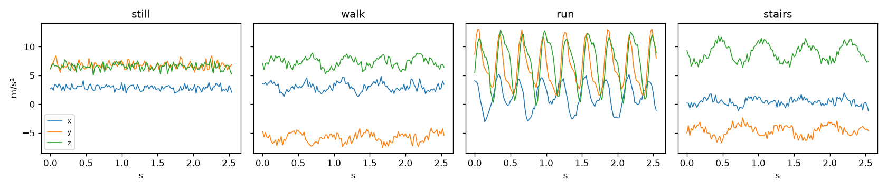
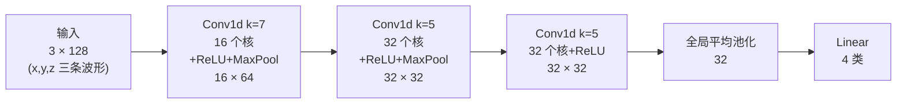

# 实战：神经网络识别人体动作

> 对应原站：[实战：神经网络识别人体动作](https://labuladong.online/zh/ai-coding/machine-learning/ml-activity-recognition/)（会员内容；本章为独立原创重写）

> **一句话结论**：同样是神经网络，「把 384 个数摊平喂进去」的 MLP 会死记硬背、卡在 90%；让同一个小卷积核沿时间轴滑动的 1D-CNN，参数少 8 倍，测试准确率反而到 95%——**结构里写进去的先验，比参数量更值钱**。

手机揣在兜里，它怎么知道你是在走路、跑步，还是在爬楼梯？

它手里只有三条曲线：加速度计（accelerometer）在 x、y、z 三个方向上每秒测 50 次的读数。没有摄像头，没有 GPS。

上一章 [手写神经网络](01-ml-neural-network.md) 说神经网络能「自己学特征」。这一章就拿一个真问题来检验这句话：给它 2.56 秒的三轴波形，让它判断动作。顺便看看，同样是神经网络，结构不同差别能有多大。

## 先跑起来看结果

代码在 `code/ml/nn/`，一条命令跑完数据生成、三个模型的训练和评估：

```text
❯ cd code/ml && uv run python nn/har_train.py
train=(2400, 3, 128) val=(600, 3, 128) test=(600, 3, 128) classes=['still', 'walk', 'run', 'stairs']

== baseline: 7 个手工特征 + 逻辑回归 ==
  test_acc=0.810

== MLP  params=66,308 ==
  epoch  1  loss=1.0817  train_acc=0.569  val_acc=0.548
  epoch 10  loss=0.2077  train_acc=0.890  val_acc=0.830
  epoch 20  loss=0.0868  train_acc=0.986  val_acc=0.883
  epoch 30  loss=0.0396  train_acc=0.996  val_acc=0.888
  test_acc=0.903  time=1.2s
  confusion (rows=true, cols=pred): ['still', 'walk', 'run', 'stairs']
     still [150   0   0   0]
      walk [  0 114   0  36]
       run [  0   0 150   0]
    stairs [  1  21   0 128]

== 1D-CNN  params=8,228 ==
  epoch  1  loss=1.2532  train_acc=0.570  val_acc=0.577
  epoch 10  loss=0.2856  train_acc=0.846  val_acc=0.832
  epoch 20  loss=0.2266  train_acc=0.885  val_acc=0.868
  epoch 30  loss=0.1380  train_acc=0.962  val_acc=0.935
  test_acc=0.952  time=29.9s
  confusion (rows=true, cols=pred): ['still', 'walk', 'run', 'stairs']
     still [150   0   0   0]
      walk [  0 130   0  20]
       run [  0   0 150   0]
    stairs [  0   9   0 141]
```

（每 10 个 epoch 摘一行，完整 30 行日志跑一遍就能看到。Apple M4 Pro，CPU。）

三个数字值得记住：**81% → 90% → 95%**。还有一个反直觉的事：准确率最高的 1D-CNN，参数只有 MLP 的八分之一。

下面一层层拆开看。

## 数据：为什么自己造，而不是下载 UCI HAR

这个任务的经典数据集是 UCI HAR：30 个志愿者腰上绑着手机做 6 种动作，采样率 50 Hz，每个样本 128 个点（2.56 秒）。

我们没有用它，原因有两个：

1. 本库规定不依赖外网下载数据集，保证 `uv run` 就能复现。
2. 更重要的是教学上的理由：**合成数据的生成规则是透明的**。你知道「上楼」和「走路」到底差在哪，就能判断模型学到的是不是那个差别。

`nn/har_data.py` 沿用 UCI HAR 的采样设定（50 Hz、128 点、三轴、单位 m/s²），造了 4 种动作：

| 动作 | 竖直方向 | 关键差别 |
|---|---|---|
| still 静止 | 只有重力 + 噪声 | 几乎没有起伏 |
| walk 走路 | 1.5~2.1 Hz 正弦，幅度 1.2~2.6 | 对称的起伏 |
| run 跑步 | 2.5~3.3 Hz，幅度 4.5~7.5，带二次谐波 | 又快又猛 |
| stairs 上楼 | 1.4~2.0 Hz，幅度 1.2~2.4 | 和走路**大面积重叠**；只靠波形不对称（蹬得尖、落得平）和轻微前倾区分 |

每个样本还会叠加两种「个体差异」：手机在兜里随机旋转 ±40°（重力会分散到三个轴上），以及强度不一的传感器噪声。



看图就能感觉到难点在哪：静止和跑步一眼就能分开，**走路和上楼长得几乎一样**。这也是真实 HAR 数据里最难分的一对。

你可能会问：自己造的数据，模型学会了又能说明什么？

能说明的是「方法」：同样的数据上，不同模型差多少、错在哪。真实数据会更脏，这几个模型之间的强弱关系大概率能迁移过去（这是推测，依据是卷积的平移不变性和数据来源无关），但数字本身别拿去和论文比。

## 手工特征：线性模型的天花板

先回到 P5 的老办法：人来设计特征，模型只负责加权。

`handcrafted_features` 给每个窗口算 7 个数：三个轴各自的均值、标准差，加上合加速度的标准差。然后丢给逻辑回归：

```python
def handcrafted_features(X):
    mag = np.linalg.norm(X, axis=1)
    return np.concatenate([X.mean(2), X.std(2), mag.std(1, keepdims=True)], axis=1)
```

结果 81%。

它为什么上不去？因为这 7 个数只描述了「晃得多厉害」，没描述「怎么晃」。走路和上楼晃的幅度差不多，只有波形的形状不同——而「形状」恰恰是我们没想到要算的特征。

这就是 [手写神经网络](01-ml-neural-network.md) 里说的：**找特征才是难点**。

## MLP：会学特征，但学得太死

MLP 的做法很粗暴：把 3×128 摊平成 384 个数，接两层 128 维的隐藏层。

```python
nn.Sequential(
    nn.Flatten(),
    nn.Linear(3 * 128, 128), nn.ReLU(),
    nn.Linear(128, 128), nn.ReLU(),
    nn.Linear(128, 4),
)
```

它确实比手工特征强（90%），说明它从原始波形里学到了一些形状信息。

但看日志的最后一行：`train_acc=0.996  val_acc=0.888`。训练集几乎全对，验证集差了 11 个点。这是典型的过拟合（overfitting）。

你可能会问：为什么会过拟合？数据不是有 2400 条吗？

问题出在 MLP 的第一层。它给 384 个输入位置**每一个都配了独立的权重**。第 10 个采样点出现一个波峰，和第 60 个采样点出现一个波峰，在它眼里是两件毫不相干的事，要分别学。

可是对动作识别来说，「什么时候迈的这一步」根本不重要，重要的是「这一步长什么样」。MLP 被迫把同一个模式在 128 个位置上各学一遍，数据就不够用了，只好去背训练集里的具体样本。

## 1D-CNN：一把尺子从左扫到右

卷积（convolution）的思路正好相反：**只学一个小模板，然后拿它沿时间轴滑过去，处处比对**。

打个比方：你要在一段很长的心电图里找「早搏」。你不会给每一毫秒单独定一条规则，而是记住早搏长什么样，然后拿这个样子从头到尾比一遍。卷积核（kernel）就是那个「样子」。

这个比方不成立的地方是：卷积核不是人画的，是训练出来的；而且一层有很多个核（第一层 16 个），各自学一种局部形状，后面的层再把局部形状组合成更大的形状。



图注：每一层的核都在时间轴上滑动，**同一组权重在所有位置共享**。第三层每个输出点能「看到」原始信号里大约 34 个采样点（0.68 秒，差不多一步多一点）。最后的全局平均池化（global average pooling）把时间维度直接平均掉——「这个形状出现在第几秒」的信息被主动丢弃了。

对应代码 `CNN1D`：

```python
self.features = nn.Sequential(
    nn.Conv1d(3, 16, kernel_size=7, padding=3), nn.ReLU(), nn.MaxPool1d(2),   # 128 -> 64
    nn.Conv1d(16, 32, kernel_size=5, padding=2), nn.ReLU(), nn.MaxPool1d(2),  # 64 -> 32
    nn.Conv1d(32, 32, kernel_size=5, padding=2), nn.ReLU(),
    nn.AdaptiveAvgPool1d(1),
)
self.head = nn.Linear(32, n_classes)
```

参数为什么这么少？第一层每个核只有 3×7=21 个权重，16 个核才 336 个参数，不管输入多长都是这么多。MLP 的第一层是 384×128=49152 个。

这就是标题那句话的意思：CNN 把「平移不变性」这个先验（prior）直接写进了结构，不用再从数据里学。省下来的数据量，全部用在了学「形状」上。结果是 `train_acc=0.962 val_acc=0.935`，训练和验证几乎同步，没怎么过拟合。

说实话，CNN 在这里赢得并不轻松：它训练要 30 秒，是 MLP 的 25 倍（卷积在 CPU 上不划算），前 10 个 epoch 还一直落后 MLP。如果你只训 15 个 epoch，两者准确率几乎一样（我第一次就是这么跑的，CNN 87.7% vs MLP 88.8%）。**结构先验的好处要训练足够久才显现出来**，别看前几轮就下结论。

## 错在哪：混淆矩阵

两个模型的混淆矩阵（confusion matrix）错的地方完全一样：静止和跑步全对，错误全部集中在 walk ↔ stairs 这一对上。MLP 错了 58 个（其中 57 个是 walk/stairs 互判），CNN 把它压到了 29 个。

这和数据的生成规则完全对得上：它俩步频和幅度重叠，只靠波形的不对称区分。模型找到了那个「蹬得尖、落得平」的形状，只是在噪声大、手机转得厉害的样本上还会看走眼。

**回到主线**：这一章和 LLM 没有直接关系，但有一个概念会一路用到 Transformer——**模型一次只能看见一个固定长度的窗口**。这里是 128 个采样点，窗口外发生了什么它一概不知；LLM 的上下文窗口（context window）是同一件事。另一个要带走的是「把先验写进结构」：CNN 写进了平移不变性，Transformer 的注意力写进了「任意两个位置都能直接交换信息」。

## 对照你的环境

- **窗口 = 上下文**：1D-CNN 判断一个 2.56 秒窗口，完全不知道前一个窗口发生了什么。Claude Code 里一个 Sub Agent 也是这样：它只看得到派发时塞给它的那段上下文，主会话里的其他东西它一概不知（见 [Sub Agent：上下文管理的艺术](../p1-tools/10-sub-agent.md)）。想让它判断准，就得像选窗口长度一样，想清楚「它需要看到多少」。
- **标准化只用训练集统计量**（`standardize` 函数）：这个习惯直接对应你给 skill 或 prompt 做评估时的纪律——**调 prompt 用的样例不能拿来当最终测试**，否则就像把测试集的均值方差漏进了训练，分数虚高。

## 常见坑

1. **测试集参与了标准化**。`mean/std` 必须只在训练集上算，再拿去变换验证集和测试集。`test_standardize_uses_train_stats_only` 专门测了这一点。
2. **Conv1d 的输入形状是 `(batch, channels, length)`**，不是 `(batch, length, channels)`。三轴数据要放在第 1 维，放反了不会报错（128 也是个合法的通道数），只会训出一个莫名其妙的模型。
3. **只看总准确率**。95% 听起来很好，但混淆矩阵告诉你所有错误都在 walk/stairs 上。如果你的产品恰好只关心爬楼（比如算爬了几层），这个模型其实不能用。
4. **训练轮数太少就比较模型**。本章 15 个 epoch 时 MLP 还略好，30 个 epoch 后 CNN 反超 5 个点。
5. **随机种子没固定**。`main()` 在创建每个模型前都 `torch.manual_seed(0)`，否则每次跑出来的数字都不一样，没法对比。

## 练习

1. 把 `har_data.py` 里上楼的不对称系数（`** 0.7 * 1.2` 和 `* 0.8`）改成完全对称，重新训练。walk/stairs 的混淆会变成什么样？这验证了模型学的到底是什么特征。
2. 给 `CNN1D` 去掉 `AdaptiveAvgPool1d`，改成 `Flatten` 后接 Linear。参数量和测试准确率各变成多少？用「平移不变性」解释结果。
3. （开放）真实的 HAR 任务里，用户可能连续做几个动作，窗口刚好跨在「走路→上楼」的边界上。你会怎么设计数据和标签来处理这种情况？可以参考 LLM 处理超长文本时的「滑动窗口 + 重叠」思路。

## 延伸阅读

- UCI HAR 数据集说明：<https://archive.ics.uci.edu/dataset/240/human+activity+recognition+using+smartphones>
- PyTorch `nn.Conv1d` 文档：<https://pytorch.org/docs/stable/generated/torch.nn.Conv1d.html>
- 本章代码：`code/ml/nn/har_data.py`、`code/ml/nn/har_train.py`、测试 `code/ml/nn/test_har.py`
- 下一章 [反向传播：手写自动求导引擎](03-ml-backpropagation.md)：上面这 8228 个参数的梯度，`loss.backward()` 到底是怎么算出来的
