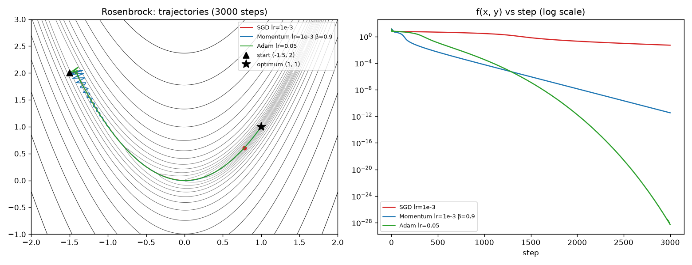
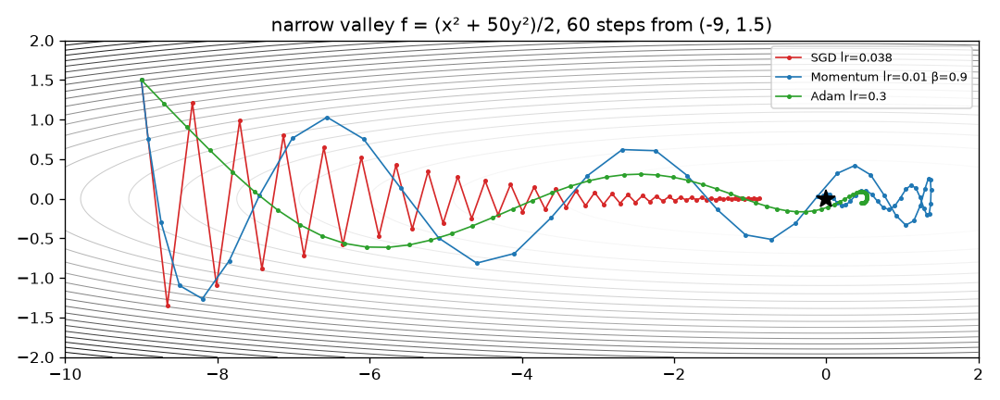
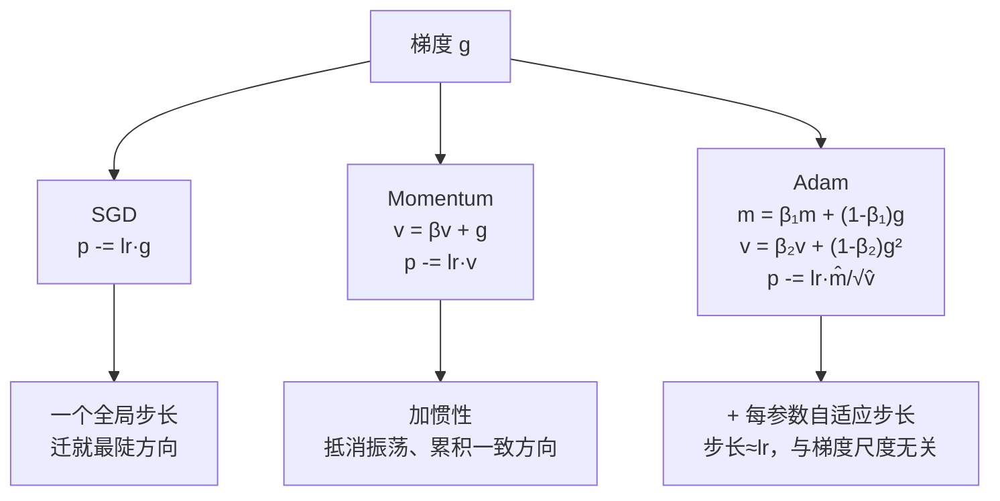

# 优化器：Momentum 和 Adam

> 对应原站：[优化器：Momentum 和 Adam](https://labuladong.online/zh/ai-coding/machine-learning/ml-optimizers/)（会员内容；本章为独立原创重写）

> **一句话结论**：SGD 所有方向共用一个学习率，所以学习率只能迁就最陡的那个方向，平缓方向就走得极慢；Momentum 靠「惯性」把来回振荡抵消掉、把一致的方向累积起来，Adam 再给每个参数单独配一个步长。三者都只是改了 `p -= lr * g` 这一行。

上一章我们手写了反向传播，梯度到手之后，更新参数只用了一行：

```python
p.data -= lr * p.grad
```

可是你翻 [实战：神经网络识别人体动作](02-ml-activity-recognition.md) 的代码，会发现训练用的是 `torch.optim.Adam`；第 6 章 LoRA 微调用的是 `AdamW`。几乎没人在训练神经网络时用这一行最朴素的写法。

你可能会问：梯度已经指明了下降最快的方向，照着走不就行了，还要优化什么？

问题恰恰在「下降最快」这四个字上。最陡的方向，往往不是通向最低点的方向。

## 先跑起来看看

`code/ml/nn/optimizers.py` 手写了三个优化器，在 Rosenbrock 函数上比赛。Rosenbrock 是优化算法的经典考题：

$$f(x, y) = (1-x)^2 + 100\,(y - x^2)^2$$

最低点在 $(1, 1)$，$f=0$。它的地形是一条弯弯的、两壁陡峭、底部几乎平坦的香蕉形山谷。我们从 $(-1.5, 2)$ 出发，每个优化器走 3000 步：

```text
❯ cd code/ml && uv run python nn/optimizers.py
SGD 学习率扫描（更大就发散）：
  SGD lr=0.001             距最优点 (1,1) 的距离  100:2.5179  500:2.1272  1000:1.7509  3000:0.4507
  SGD lr=0.002             距最优点 (1,1) 的距离  100:0.0709  500:0.0510  1000:0.0339  3000:0.0068
  SGD lr=0.003             距最优点 (1,1) 的距离  100:diverged  500:diverged  1000:diverged  3000:diverged

三种优化器对比：
  SGD lr=1e-3              距最优点 (1,1) 的距离  100:2.5179  500:2.1272  1000:1.7509  3000:0.4507
  Momentum lr=1e-3 β=0.9   距最优点 (1,1) 的距离  100:1.7142  500:0.1451  1000:0.0168  3000:0.0000
  Adam lr=0.05             距最优点 (1,1) 的距离  100:2.3486  500:0.6511  1000:0.0405  3000:0.0000

saved /Users/me/agent-learn/p6-nn-llm/img/optimizers-rosenbrock.png

狭长山谷：
  SGD lr=0.038             60 步后 f=0.38785
  Momentum lr=0.01 β=0.9   60 步后 f=0.05735
  Adam lr=0.3              60 步后 f=0.17182
saved /Users/me/agent-learn/p6-nn-llm/img/optimizers-valley.png
```



先看第一段，SGD 的学习率扫描，这是整章最有信息量的三行：

- `lr=0.001`：稳，但慢。3000 步后还离终点 0.45。
- `lr=0.002`：意外地不错，3000 步到 0.0068。
- `lr=0.003`：直接发散，坐标飞到无穷大。

能用的学习率窗口只有 0.001 到 0.002 这么窄一条，大一点点就炸。而同样学习率 `1e-3` 的 Momentum，3000 步后已经精确到达 $(1,1)$。

右边的损失曲线（对数坐标）更直观：红色的 SGD 几乎是一条平线，蓝色 Momentum 和绿色 Adam 一路往下掉了十几个数量级。

## SGD 为什么被卡住：狭长山谷

Rosenbrock 有点复杂，换个更干净的地形来看清机制：

$$f(x, y) = \tfrac{1}{2}(x^2 + 50y^2)$$

一个椭圆形的碗。$x$ 方向很平（系数 1），$y$ 方向很陡（系数 50）。最低点在原点。



红线是 SGD。它在 $y$ 方向上来回横跳，像一个球在 U 形管里左右撞墙；$x$ 方向却慢吞吞地挪，60 步后才走到 $-0.88$ 附近。

原因很简单。SGD 的更新是 $p \leftarrow p - \eta\, g$，两个方向用同一个 $\eta$：

- $y$ 方向梯度是 $50y$。每一步 $y \leftarrow (1 - 50\eta)\,y$。只要 $\eta > 0.04$，$|1-50\eta| > 1$，$y$ 就越跳越远，发散。
- $x$ 方向梯度是 $x$。每一步 $x \leftarrow (1-\eta)\,x$。$\eta = 0.038$ 时，每步只缩小 3.8%。

**学习率的上限由最陡的方向决定，收敛速度却由最平的方向决定。** 两个方向的陡峭程度差 50 倍，SGD 就只能以最平方向能接受的最慢速度前进。

神经网络的损失地形里，这种「某些方向陡、某些方向平」的情况是常态，而且参数有几百万个，陡峭程度能差上万倍。这就是 SGD 在深度学习里不好用的根本原因。

## Momentum：给小球加上惯性

Momentum（动量）的想法来自物理：别让小球每一步都只看脚下的坡，让它带着速度滚。

```python
class Momentum:
    def step(self, p, g):
        self.v = g.copy() if self.v is None else self.beta * self.v + g
        return p - self.lr * self.v
```

`v` 是「速度」，每一步先打个折（$\beta = 0.9$，保留九成），再加上新的梯度。参数沿着速度方向走。

为什么这能解决振荡？想想 $y$ 方向：梯度一会儿正一会儿负，加进 `v` 里互相抵消，速度反而不大。$x$ 方向：梯度一直是同一个符号，一步步累积，速度越来越快——稳态下大约放大到 $1/(1-\beta) = 10$ 倍。

打个比方：一辆车在搓板路上开，方向盘每秒被路面颠得左右抖。车身有质量，抖动被惯性吸收了，车整体还是往前走。

这个比方不成立的地方：真车有摩擦会自己停下来，Momentum 的「摩擦」只有 $\beta$ 这个衰减系数，衰减不够时它会冲过头。看山谷图里蓝线在原点附近绕了一圈才停下，就是惯性过头了。Momentum 不是没有振荡，而是**把高频的来回横跳换成了低频的冲过头再折返**，后者效率高得多。

这个实现和 `torch.optim.SGD(momentum=0.9)` 的定义完全一致（`test_matches_torch_optim` 验证了 200 步的完整轨迹，误差 < 1e-6）。注意它不是有些教材里的 $v \leftarrow \beta v + (1-\beta) g$ 写法，两者差一个常数倍，等价于换了学习率。

## Adam：每个参数配一个自己的步长

Momentum 解决了振荡，但所有参数还是共用同一个 $\eta$。能不能让陡的方向自动迈小步、平的方向自动迈大步？

Adam（Adaptive Moment Estimation）就是这么做的。它维护两个滑动平均：

```python
class Adam:
    def step(self, p, g):
        self.t += 1
        self.m = self.b1 * self.m + (1 - self.b1) * g       # 梯度的平均：往哪走
        self.v = self.b2 * self.v + (1 - self.b2) * g * g   # 梯度平方的平均：这个方向通常多陡
        m_hat = self.m / (1 - self.b1 ** self.t)            # 偏差修正
        v_hat = self.v / (1 - self.b2 ** self.t)
        return p - self.lr * m_hat / (np.sqrt(v_hat) + self.eps)
```

核心是最后一行：`m_hat / sqrt(v_hat)`。分子是 Momentum 那样的平均梯度，分母是「这个参数平时梯度有多大」。**梯度大的参数被除以一个大数，梯度小的被除以一个小数。** 结果每个参数的实际步长都在 `lr` 这个量级上，和梯度本身的尺度无关。

`test_adam_first_step_is_lr_regardless_of_grad_scale` 演示了这件事：两个参数的梯度一个是 $10^{-4}$，一个是 $10^{4}$，差了 8 个数量级，Adam 第一步让它们都移动了 0.1。

你可能会问：偏差修正那两行是干什么的？

`m` 和 `v` 都从 0 开始。第一步时 $m = 0.1g$，被初始值 0 拖小了 10 倍；$v = 0.001 g^2$，被拖小了 1000 倍。除以 $1-\beta^t$ 就是把这个「冷启动」的偏差补回来。$t$ 大了以后 $\beta^t \to 0$，修正项趋近于 1，自然失效。

所以 Adam 的学习率和 SGD 的学习率不是一回事：SGD 的 `lr` 乘的是梯度，要配合梯度大小来调（Rosenbrock 上 0.003 就炸）；Adam 的 `lr` 几乎就是「每步最多走多远」，Rosenbrock 上用 0.05 很稳。这也是为什么 Adam 的默认 `lr=1e-3` 在大多数网络上都能用——它不太挑问题。

说实话，Adam 不是在所有问题上都赢。山谷图里 60 步后 Momentum 的 $f$ 比 Adam 低（0.057 vs 0.172），Rosenbrock 上前 1000 步 Momentum 也领先。Adam 的优势是**省心**：你不用为每个问题精调学习率，换个网络结构它通常也能直接工作。对于要训练几百个不同实验的人来说，这个省心比峰值性能更值钱。



图注：三个优化器的输入都是同一个梯度，区别只在「梯度怎么变成位移」。每往下一层，优化器要为每个参数多记一份状态：SGD 零份，Momentum 一份（`v`），Adam 两份（`m` 和 `v`）。

`nn/test_optimizers.py` 把三个手写优化器和 `torch.optim` 的 SGD / SGD(momentum) / Adam 逐步对齐 200 步轨迹，并断言了「Adam 第一步与梯度尺度无关」「1000 步时 Momentum 和 Adam 离终点的距离都不到 SGD 的十分之一」「SGD lr=3e-3 发散」：

```text
❯ uv run pytest -q nn/test_optimizers.py
.......                                                                  [100%]
7 passed in 0.90s
```

**回到主线**：优化器决定了模型「怎么学」，但不改变「学什么」——LLM 学的始终是预测下一个 token。这里和上下文工程有一个有意思的对应：Adam 的状态 `m`、`v` 是优化器在训练过程中积累的「记忆」，每个参数两份。对一个 1.35 亿参数的模型，这就是额外 2.7 亿个浮点数。**训练的成本，很大一部分花在了存这些记忆上**，这直接引出第 6 章为什么 LoRA 只训练 0.68% 的参数。

## 对照你的环境

- **Adam 状态 ↔ LoRA 省下的显存**：第 6 章用 AdamW 微调 SmolLM2-135M。全量微调要为 1.35 亿参数各存 `m`、`v`（fp32 约 1 GiB 光是优化器状态）；LoRA 只训练 92 万个参数，优化器状态只剩 7 MiB 左右。在你的 M4 Pro 上几分钟能跑完，这是主要原因之一。
- **学习率 warmup**：第 6 章训练循环里有一行 `min(1.0, (s + 1) / 10)`，前 10 步学习率从小到大爬升。原因就是本章讲的偏差修正之外的另一层保险：训练刚开始时 Adam 的 `v` 估计还不准，步子迈太大容易把预训练好的权重冲坏。

## 常见坑

1. **把 SGD 的学习率直接搬给 Adam（或反过来）**。两者的 `lr` 含义不同：SGD 在 Rosenbrock 上 0.003 就发散，Adam 用 0.05 才合适。换优化器一定要重新扫学习率。
2. **Momentum 的两种写法混用**。PyTorch 是 $v = \beta v + g$，有些资料是 $v = \beta v + (1-\beta)g$。后者的稳态速度小 10 倍，同样的 `lr` 下走得慢很多。
3. **以为 Adam 永远最好**。本章两个地形上 Momentum 前期都比 Adam 快。Adam 赢在稳健，不是在每个问题上都最快。
4. **Adam 的 `eps` 不是摆设**。`v_hat` 接近 0 时（某个参数梯度长期为 0），没有 `eps` 就会除以 0。fp16 训练时 `1e-8` 甚至会下溢成 0，需要调大。
5. **Adam vs AdamW**：Adam 把 L2 正则加在梯度上，会被 `sqrt(v)` 一起缩放，正则效果被扭曲；AdamW 把权重衰减（weight decay）从梯度里拆出来单独做。训练 Transformer 一般用 AdamW。

## 练习

1. 在狭长山谷上把 SGD 的学习率改成 0.041，跑 60 步，观察 $y$ 坐标的变化。用「$|1-50\eta|$」解释你看到的现象。
2. 给 `optimizers.py` 加一个 RMSProp（只有 Adam 的 `v`，没有 `m` 和偏差修正），并像 `test_matches_torch_optim` 一样和 `torch.optim.RMSprop` 对齐轨迹。提示：PyTorch 的 RMSprop 默认 `alpha=0.99`、`eps` 加在开方之后。
3. （开放）Adam 给每个参数「自适应」步长，依据的是梯度平方的历史平均。如果某个参数的梯度长期接近 0、偶尔突然很大（比如 LLM 里很少出现的 token 对应的嵌入向量），Adam 会怎么对待它？这是好事还是坏事？

## 延伸阅读

- Adam 原始论文：Kingma & Ba, *Adam: A Method for Stochastic Optimization*，<https://arxiv.org/abs/1412.6980>
- AdamW：Loshchilov & Hutter, *Decoupled Weight Decay Regularization*，<https://arxiv.org/abs/1711.05101>
- PyTorch 优化器文档（含各自的精确更新公式）：<https://pytorch.org/docs/stable/optim.html>
- 本章代码：`code/ml/nn/optimizers.py`，测试 `code/ml/nn/test_optimizers.py`
- 下一章 [动手跑通 LLM 推理的全流程](05-inference-process.md)：模型训练好了，怎么让它开口说话
