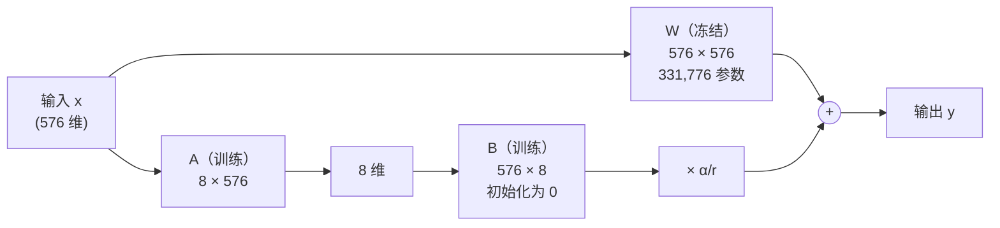

# 动手用 LoRA 微调模型

> 对应原站：[动手用 LoRA 微调模型](https://labuladong.online/zh/ai-coding/llm/lora-fine-tuning/)（会员内容；本章为独立原创重写）

> **一句话结论**：LoRA 冻住原模型的全部权重，只在若干个 Linear 旁边并联一对低秩小矩阵 $B A$，训练这 0.68% 的参数就能教会模型一个新任务；它改的是权重，所以效果是「内化」的，但学到多少取决于数据有多丰富，而不是训练多少步。

你写了 40 多个 skill，每个都在教 Claude「遇到这类事该怎么做」。它们有个共同点：全部是文字，每次用到都要塞进上下文，占 token、占注意力。

你可能会想：如果能直接把这些规矩「刻进模型里」呢？不用每次提醒，模型天生就会。

这就是微调（fine-tuning）。对 Claude 你做不到（API 不开放权重），但对一个开源小模型，你在笔记本上一分钟就能做到。这一章我们从零写一个 LoRA，教上一章那个 1.35 亿参数的 SmolLM2 做一件它原本完全不会的事：把客服工单路由成一段严格格式的 JSON。

## 先跑起来看看

任务是这样的：用户随便说一句话，模型必须只输出 `{"route": ..., "priority": ...}`。`route` 只能是 account / billing / bug / feature / unknown 之一，`priority` 只能是 high / medium / low 之一。

```text
❯ cd code/ml && HF_HUB_OFFLINE=1 uv run python llm/lora_finetune.py
device=mps  train=400  test=100（测试集句子主干训练时没见过）
样例: Hey team, add a way to share folders with my team. → {"route": "feature", "priority": "medium"}

[微调前] valid_json=0.00  exact=0.00
    'Hey team, I need a VAT invoice for my company. No rush.'
      → "I'm sorry for the misunderstanding, but as an AI, I don't have the ability to access or process VAT inv"
    'Hello, could you add tags to notes. Thanks.'
      → "Sure, I can help with that. Here's how you can add tags to notes:\n\n**Track Notes:**"
    "Hello, my username shows someone else's name."
      → "You're trying to send a message to someone else's account, but the username is not the same as the one you"

注入 LoRA 到 120 个 Linear（例：model.layers.0.self_attn.q_proj）
可训练参数 921,600 / 总参数 135,436,608 = 0.680%

[训练]
  step   0  loss=1.4064  lr=3.97e-04    0.7s
  step  25  loss=0.1975  lr=1.65e-03    9.6s
  step  50  loss=0.0143  lr=1.32e-03   18.2s
  step  75  loss=0.0009  lr=9.87e-04   26.9s
  step 100  loss=0.0005  lr=6.53e-04   35.6s
  step 125  loss=0.0004  lr=3.20e-04   44.1s
  step 149  loss=0.0004  lr=0.00e+00   52.5s
  训练耗时 52.5s

[微调后] valid_json=0.93  exact=0.74  route_acc=0.74  priority_acc=0.93
    'Hey team, I need a VAT invoice for my company. No rush.'
      → '{"route": "billing", "priority": "low"}'
    'Hello, could you add tags to notes. Thanks.'
      → '{"route": "feature", "priority": "medium"}'
    "Hello, my username shows someone else's name."
      → '{"route": "account", "priority": "medium"}'
  失败样例（共 26 条，列前 6 条）：
    'Hi, let me pin important notes. No rush.'
      期望 {"route": "feature", "priority": "low"}
      实际 '{"route": "bug", "priority": "low"}'
    'Hi, do you like pizza. No rush.'
      期望 {"route": "unknown", "priority": "low"}
      实际 '{"route": "baking", "priority": "low"}'
    'Hi, do you like pizza. Please help immediately.'
      期望 {"route": "unknown", "priority": "high"}
      实际 '{"route": "baking", "priority": "high"}'
    'Hey team, let me pin important notes. Whenever you get a chance.'
      期望 {"route": "feature", "priority": "low"}
      实际 '{"route": "bug", "priority": "low"}'
    'I want to merge two accounts. Please take a look.'
      期望 {"route": "account", "priority": "medium"}
      实际 '{"route": "billing", "priority": "medium"}'
    'Hello, could you add tags to notes. Our whole team is blocked.'
      期望 {"route": "feature", "priority": "high"}
      实际 '{"route": "bug", "priority": "high"}'

适配器只需保存 240 个张量，3.52 MiB（原模型 fp32 约 517 MiB）
merge 进原权重后 exact=0.74（应与微调后一致）
```

（Apple M4 Pro，mps 后端，整个脚本约 1 分钟。）

微调前：0% 合法 JSON。system prompt 里明明写了「Reply with JSON only」，这个 1.35 亿参数的小模型完全不理，自顾自地开始道歉、教你怎么加标签。

微调后：93% 合法 JSON，74% 完全正确。只训练了 92 万个参数，53 秒。

还有两个细节值得先记下：一是失败样例里出现了一个**根本不在候选列表里的标签** `baking`；二是 loss 降到了 0.0004，测试准确率却只有 74%。这两件事后面都会解释。

## 原理：在大矩阵旁边并联一个小矩阵

先想想全量微调要做什么。SmolLM2 每一层注意力里的 `q_proj` 是一个 576×576 的矩阵，33 万个参数；30 层、4 个投影、再加上 MLP，总共 1.35 亿个参数全部要算梯度、全部要存 Adam 状态（[上一章](04-ml-optimizers.md) 算过，光优化器状态就是 1 GiB）。

LoRA（Low-Rank Adaptation）的假设是：**学一个新任务需要的权重改动 $\Delta W$，是「低秩」的**。也就是说，这个 576×576 的改动矩阵，可以近似写成一个 576×8 和一个 8×576 的矩阵之积。

$$y = W x + \frac{\alpha}{r} \cdot B(Ax),\qquad W \in \mathbb{R}^{d_{out}\times d_{in}}\ \text{冻结},\quad A \in \mathbb{R}^{r\times d_{in}},\ B \in \mathbb{R}^{d_{out}\times r}$$



图注：原来的路径原封不动；旁边多了一条「先压到 8 维、再放回 576 维」的小路。两条路的结果相加。一个 `q_proj` 的 LoRA 只有 $8 \times (576+576) = 9216$ 个参数，是原矩阵的 2.8%。

打个比方：一本 500 页的教科书（原模型），你不去改正文，而是在旁边贴便利贴（LoRA）。便利贴很小，但贴在关键位置，读的人看到的就是「正文 + 批注」。

这个比方不成立的地方是：便利贴是读者看得见、能单独撕下来读的，LoRA 的 $BA$ 不是。它只有和原始 $W$ 加在一起才有意义；单独拿出来是一堆看不懂的数，换一个基座模型就完全失效。

### 三个关键设计

`llm/lora.py` 的 `LoRALinear` 只有 40 来行，核心是三处：

```python
class LoRALinear(nn.Module):
    def __init__(self, base: nn.Linear, r=8, alpha=16, dropout=0.0):
        super().__init__()
        self.base = base
        for p in self.base.parameters():
            p.requires_grad_(False)                     # ① 冻结原权重
        self.scaling = alpha / r                        # ② 缩放
        self.lora_A = nn.Parameter(torch.empty(r, base.in_features))
        self.lora_B = nn.Parameter(torch.zeros(base.out_features, r))   # ③ B 初始化为 0
        nn.init.kaiming_uniform_(self.lora_A, a=math.sqrt(5))

    def forward(self, x):
        out = self.base(x)
        if self.merged:
            return out
        return out + (self.dropout(x) @ self.lora_A.T @ self.lora_B.T) * self.scaling
```

**① 冻结**：`requires_grad_(False)` 之后，[反向传播](03-ml-backpropagation.md) 根本不会为 $W$ 算梯度，优化器也不会为它存状态。显存和计算都省在这里。

**② 缩放 $\alpha/r$**：你可能会问，乘一个常数有什么用，学习率不就能吸收吗？用处在于**换 $r$ 时不用重调学习率**。$r$ 变大，$BA$ 的输出量级会跟着变；除以 $r$ 把它拉回来。实践中常把 $\alpha$ 设成 $r$ 的 1~2 倍，然后只调 $r$。

**③ B 初始化为 0**：所以刚注入时 $BA = 0$，模型输出和原模型**一模一样**。训练从「原模型」这个好起点出发，而不是从一个被随机噪声扰乱的版本出发。A 不能也是 0，否则 B 的梯度 $\propto A x = 0$，两个矩阵永远学不动。

`test_fresh_lora_is_identity_and_base_frozen` 断言了注入后输出不变、原权重冻结、可训练参数恰好是 $r(d_{in}+d_{out})$。

### merge：训练完就消失

推理时多一条小路会不会变慢？可以把它「合并」回去：

```python
@torch.no_grad()
def merge(self):
    self.base.weight += self.scaling * (self.lora_B @ self.lora_A)
    self.merged = True
```

$W' = W + \frac{\alpha}{r}BA$ 还是一个 576×576 的矩阵，推理开销和原模型完全一样。运行日志最后一行：merge 之后测试准确率仍是 0.74。`test_merge_equals_unmerged_and_unmerge_restores` 也验证了 merge 前后输出一致、unmerge 能精确还原。

## 动手：数据、训练、评估

### 注入：替换 120 个 Linear

```python
replaced = inject_lora(model, target=("q_proj", "k_proj", "v_proj", "o_proj"), r=8, alpha=16)
```

`inject_lora` 遍历模型，把名字匹配的 `nn.Linear` 原地换成 `LoRALinear`，并冻结所有其他参数。30 层 × 4 个投影 = 120 个。

参数量逐个算一下（这个模型用 GQA，k/v 只投到 3×64=192 维）：

| 投影 | 形状 | LoRA 参数 $8(d_{in}+d_{out})$ |
|---|---|---|
| q_proj | 576→576 | 9,216 |
| k_proj | 576→192 | 6,144 |
| v_proj | 576→192 | 6,144 |
| o_proj | 576→576 | 9,216 |
| 每层合计 | | 30,720 |
| × 30 层 | | **921,600** |

和日志里的 `可训练参数 921,600` 对得上，占总参数的 0.68%。保存下来的适配器只有 3.52 MiB。

### 数据：故意让测试集「没见过」

`llm/ticket_data.py` 用模板合成工单：每类 8 个句子主干（如 "I was charged twice this month"）× 优先级修饰语（"This is urgent!" / "No rush." / ...）× 开场白。

关键在这一行：

```python
HELD_OUT = 2  # 每类最后 2 句只用于测试
```

每类的最后 2 个主干**只出现在测试集**。所以测试准确率衡量的是「学会了规则」，不是「背下了句子」。`test_ticket_split_holds_out_stems` 守着这条线。

### 训练：只对回答部分算 loss

```python
def encode(tok, ex):
    prompt = tok.apply_chat_template(messages(ex["text"]), add_generation_prompt=True, tokenize=False)
    answer = target_json(ex["route"], ex["priority"]) + "<|im_end|>"
    p_ids = tok(prompt, add_special_tokens=False).input_ids
    a_ids = tok(answer, add_special_tokens=False).input_ids
    return p_ids + a_ids, [-100] * len(p_ids) + a_ids
```

prompt 部分的 label 设成 -100，`CrossEntropyLoss` 会忽略它们。模型只为「回答」那十几个 token 的下一个 token 预测负责——这还是 [上一章](05-inference-process.md) 讲的 next-token prediction，只是我们挑了哪些位置算分。

回答末尾的 `<|im_end|>` 很重要：它教会模型「说完 JSON 就停」。

训练循环本身和第 2 章训练 1D-CNN 没什么区别：AdamW、学习率 2e-3（LoRA 一般比全量微调用更大的学习率，因为参数少、而且从 0 开始）、前 10 步 warmup、线性衰减到 0、150 步、batch 16。

### 结果怎么读

**priority 93%，route 74%。** 为什么差这么多？

因为优先级修饰语（"No rush." 等）训练集和测试集用的是同一批，模型见过；route 的判断依据是句子主干，测试集的主干全部是新的。每类只有 6 个训练主干，模型能学到的「什么叫 billing」非常有限。

**loss 0.0004，准确率 74%。** loss 已经接近 0，说明训练集上几乎全对——它把那 30 个训练主干背得滚瓜烂熟。剩下的差距完全是泛化问题，**再多训 1000 步也不会好**，只能靠更丰富的数据。

**`baking` 从哪来？** 测试句 "do you like pizza" 和训练集里任何一个主干都不像，模型在生成 route 的值时，`b` 开头之后走向了一个和 pizza 语义相关的词。这是一个很好的提醒：**微调没有改变模型的本质，它仍然是在逐 token 预测，不是在 5 个选项里做选择题**。微调能让「合法标签」的概率大幅升高，但不能让其他 token 的概率变成 0。

要真正保证输出落在候选集合里，得在采样那一步动手：约束解码（constrained decoding），每一步把不合法的 token 的 logits 设成 $-\infty$——和 [上一章](05-inference-process.md) 的 `apply_top_k` 是同一个手法，只是掩码换成了「语法允许的 token」。`ticket_data.parse` 则是另一道防线：解析失败或标签非法就返回 `None`，调用方可以退回 unknown。

**回到主线**：LoRA 是本库里唯一一个「不靠上下文」的方法——它直接改了「根据已有 token 预测下一个 token」的那个概率分布。代价是你需要数据、需要训练、需要能拿到权重；收益是规则被内化了，推理时不再占用上下文。它和 skill、CLAUDE.md 解决的是同一个问题（让模型按你的规矩做事），走的是相反的路。

## 同一件事用 peft 写

`peft` 是 Hugging Face 的参数高效微调库，上面的 `inject_lora` 换成它只要几行（`llm/lora_peft.py`）：

```python
from peft import LoraConfig, get_peft_model

cfg = LoraConfig(r=8, lora_alpha=16, lora_dropout=0.0,
                 target_modules=["q_proj", "k_proj", "v_proj", "o_proj"],
                 bias="none", task_type="CAUSAL_LM")
model = get_peft_model(model, cfg)
model.print_trainable_parameters()
# 训练循环完全不变
model.save_pretrained(out_dir)   # 只存适配器
```

它和我们手写的版本是不是同一个东西？脚本先做了一个等价性实验：两边各注入 LoRA，把手写版的 A、B（B 随机化以免全 0）逐个拷进 peft 版，比较输出：

```text
❯ HF_HUB_OFFLINE=1 uv run python llm/lora_peft.py
[等价性] 拷贝了 120 组 A/B，手写版 vs peft 版 max|Δlogits| = 0.00e+00
[参数量] 手写版 trainable=921,600
trainable params: 921,600 || all params: 135,436,608 || trainable%: 0.6805

[peft 训练] device=mps
  step   0  loss=1.4064  lr=3.97e-04    0.8s
  step  25  loss=0.2104  lr=1.65e-03    9.5s
  step  50  loss=0.0135  lr=1.32e-03   18.1s
  step  75  loss=0.0009  lr=9.87e-04   26.6s
  step 100  loss=0.0005  lr=6.53e-04   35.1s
  step 125  loss=0.0004  lr=3.20e-04   44.0s
  step 149  loss=0.0004  lr=0.00e+00   52.2s
  训练耗时 52.3s
[peft 微调后] valid_json=0.93  exact=0.67
save_pretrained → /var/folders/.../adapter-ticket-xxxx: adapter_model.safetensors 3631 KiB, README.md 5 KiB, adapter_config.json 1 KiB
```

（中间还有一行 peft 的 UserWarning：离线模式下它找不到基座模型的 config，假设词表没改，无害。保存目录是 `tempfile.mkdtemp` 生成的临时路径，这里省略了。）

logits 差值是精确的 0：**数学上完全相同**，参数量也一样。

那为什么 peft 版训完是 0.67 而不是 0.74？两者的 A 矩阵都是随机初始化，但随机数的消耗顺序不同，起点不一样。在只有 100 条测试样本、训练数据又很单薄的情况下，换一个起点差 7 个点很正常。这也再次说明：这个任务的瓶颈是数据，不是实现。

说实话，真做项目我会直接用 peft：它处理了 dropout、多适配器切换、量化模型（QLoRA）、保存加载这些工程细节。但手写一遍的价值在于，你会知道 `print_trainable_parameters` 那个 0.68% 是怎么算出来的，以及 `lora_B` 为什么必须从 0 开始。

## 对照你的环境

- **LoRA 适配器 ↔ skill**。两者的形状惊人地相似：基座模型冻结不动；每个任务配一个小附件（3.5 MiB 的适配器 / 一个 SKILL.md）；用到时才加载，可以随时换。区别在于附件放在哪：LoRA 放进**权重**，推理时零上下文开销，但需要训练、需要能改模型；skill 放进**上下文**，写完即用、随时修改，但每次加载都占 token。对 Claude 你只有后一条路，这也是为什么你的 CLAUDE.md 坚持「多步流程进 skill、按需加载」——在不能做 LoRA 的前提下，这就是最接近「按任务挂适配器」的做法。
- **约束解码 ↔ 结构化输出**。`baking` 这种问题在 Claude 上也会以别的形式出现（多一个字段、少一个引号）。对应的解法是 API 的 structured outputs（`output_config.format`），它在服务端做的事情，就是本章说的「每一步把不合法的 token 屏蔽掉」（这是推测，依据是它能对 JSON Schema 给出格式保证，而在逐 token 生成的模型上只有约束解码能做到这种保证）。
- **留出集纪律 ↔ skill 的评估**。`HELD_OUT = 2` 那一行对应的工程习惯：你调一个 skill 时用来试的那几个例子，不能同时拿来证明它「好用」。留几个从没给它看过的真实场景当最后的测试。

## 常见坑

1. **B 和 A 都初始化为 0**。B 的梯度依赖 $Ax$，A 的梯度依赖 $B$，两者同时为 0 就永远学不动，loss 一动不动。
2. **忘了只对回答算 loss**。prompt 部分不设 -100 的话，模型会花大量容量去学「复述 system prompt」，loss 看起来降得很好，回答格式却学不会。
3. **训练 padding 和生成 padding 用同一边**。训练时右侧 padding 配合 attention_mask 没问题；批量生成时必须左侧 padding（`evaluate` 里的 `tok.padding_side = "left"`）。
4. **把 loss 降到 0 当成成功**。本章 loss 0.0004 时测试准确率只有 74%。一定要有一个句子主干没见过的测试集。
5. **适配器和基座不匹配**。LoRA 的 $BA$ 只对训练时那个基座有意义。用 SmolLM2-135M 训的适配器挂到 SmolLM2-360M 上，形状都对不上；就算形状碰巧一样（同架构不同版本），效果也是未定义的。

## 练习

1. 把 `HELD_OUT` 改成 0（测试集和训练集用同一批主干），重新跑 `lora_finetune.py`。exact 变成多少？这个数字说明了什么？
2. 把 `target` 改成只有 `("q_proj", "v_proj")`，或者把 `r` 改成 2 和 32，记录可训练参数量和测试准确率，填一张表。参数量翻 4 倍，准确率会翻倍吗？
3. （开放）给 `STEMS` 每类加到 20 个主干（可以自己写，也可以想想怎么让 Claude 帮你批量生成——注意那就成了「用大模型给小模型造训练数据」，也就是蒸馏的雏形），看 route_acc 能涨到多少。然后思考：在什么情况下，你会选择「用 LoRA 微调一个小模型」而不是「写一个 skill 让 Claude 做」？从成本、延迟、可维护性、数据隐私几个角度比较。

## 延伸阅读

- LoRA 原始论文：Hu et al., *LoRA: Low-Rank Adaptation of Large Language Models*，<https://arxiv.org/abs/2106.09685>
- peft 文档：<https://huggingface.co/docs/peft>
- peft 的 LoRA 层实现（可以和本章的 `LoRALinear` 对照着读）：<https://github.com/huggingface/peft/blob/main/src/peft/tuners/lora/layer.py>
- 本章代码：`code/ml/llm/lora.py`、`code/ml/llm/ticket_data.py`、`code/ml/llm/lora_finetune.py`、`code/ml/llm/lora_peft.py`，测试 `code/ml/llm/test_lora.py`
- 相关章节：[用 Skills 定制你的 AI 工作流](../p1-tools/12-skills.md)、[动手跑通 LLM 推理的全流程](05-inference-process.md)
