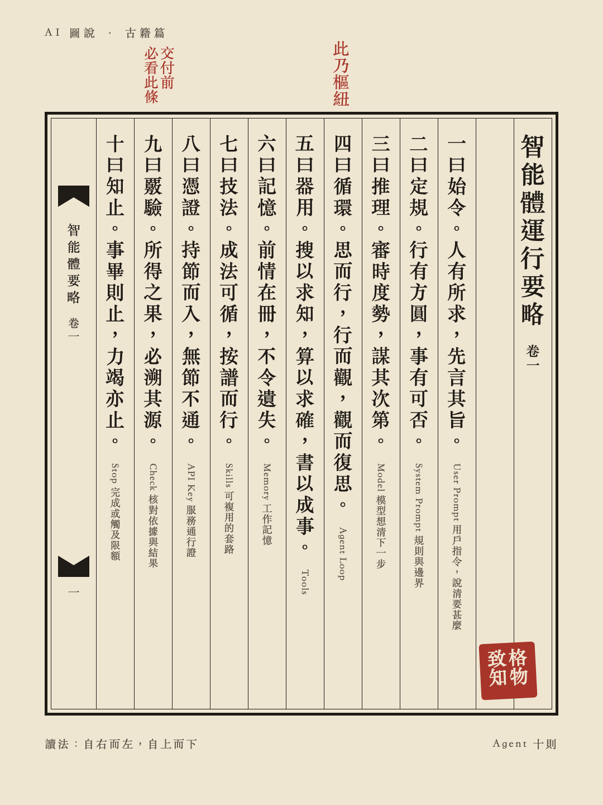

# Agent 运行线路图

**线路图回答「一个任务怎么走」，架构图回答「每一步由谁负责」。** 模型提出下一步，运行时（Harness）组织循环，执行层负责把获准的请求变成真正的读写或调用。

- [系统分层](#runtime-layers)：先看入口、运行时、模型、执行器和状态是怎么接在一起的。
- [执行边界](#execution-boundary)：再看提示词、权限和实际资源分别在哪一层起作用。
- [地铁版](#_1) / [古籍版](#_2)：最后沿着一个任务走一遍。

## 系统分层：运行时把模型、工具和状态接在一起 { #runtime-layers }

**读图：橙线连接任务入口和模型推理，青线连接工具执行，蓝线表示按需补给。** 左侧模型返回文本或工具请求，右侧执行器返回结果或错误，两侧都通过运行时衔接。[工具调用接口的典型做法](https://developers.openai.com/api/docs/guides/function-calling)也是先由模型返回请求，再由应用执行并回传结果。图里的线路表示职责关系，不是固定的执行顺序，也不规定组件部署在哪里。

比如要「读文件、改代码、跑测试」，模型可以提出调用；运行时决定是否再发起一轮推理、是否已超预算；工具执行器操作工作区，把结果或错误交回运行时。是否要把测试通过作为交付条件，取决于这个系统的验收配置，不由模型的一句「完成了」决定。

## 执行边界：指导模型和允许动作是两回事 { #execution-boundary }

**读图：提示词影响建议，网关判断要不要派发，真正的读写仍受执行环境或业务服务的约束。** 这是防护职责的示意，不是所有产品都必须有一个独立网关或每次都要弹窗审批。

以虚构的售后助手为例：模型可以建议「给这笔订单退款」，网关按策略确认订单、金额与审批范围，退款服务仍用调用身份检查是否能操作这笔订单。调用凭证由工具执行环境持有，不必塞进模型上下文。要看这些约束如何落到配置，可读[《Harness Engineering 是什么》](../p3-agent-internals/12-harness-engineering.md)。

## 地铁版：模型推理是换乘站

一次 Agent 任务有三条线：主线从指令走到交付，循环线把工具结果送回模型做下一轮判断，补给线提供按需使用的资源。这是理解运行机制的示意图，不是所有 Agent 都必须走的固定流程。

- **主线**：用户给出目标，运行时准备上下文，模型提出下一步；交付前按任务条件校验。停下来不一定是完成，也可能是达到上限或无法继续。
- **循环线**：模型提出工具请求 → 运行时或执行入口检查参数和权限，按策略决定是否审批 → 获准才调用工具 → 把结果、失败或拒绝原因交回运行时，决定是否再推理。
- **补给线**：会话状态接续当前任务，记忆复用相关信息，技能提供可复用的操作方法。它们按需加载，不是每轮必经的站点。

**凭证不是补给，而是调用端向服务证明身份或委托授权的材料。** 例如，运行时的模型适配器用 [API Key 认证托管模型请求](https://developers.openai.com/api/reference/overview/)；执行器访问外部工具时，可能用到服务身份或代表用户的委托凭证。两类调用用途不同，原始凭证都不应进入模型上下文。**能调用模型，不代表能读订单或发起退款**；工具侧还要按用户、动作和资源范围判断是否允许。完全在本地运行的模型或工具也不一定需要 API Key。

## 古籍版：从「行器符」读懂五个关口 { #_2 }

**从上往下读：受令 → 推演 → 调器 → 验果 → 知止。** 符上「器可調，不可越權」对应现代图里的工具准入：先验权，再调用。这是一张借道家符箓视觉语言画的科普插图，符头与印记均为原创装饰。

展开原古籍版：从右至左读「智能體運行要略」

原图的「憑證」指调用端出示的通行证，不是给模型看的材料；认证与授权的区别见新版地铁图和[执行边界图](#execution-boundary)。

想看循环如何落到代码里，可以接着读[动手实现一个 Coding Agent](../p2-agent-basics/02-coding-agent.md)；想看什么时候应从建议走到执行，见[《AI 怎么从试用走到业务流程》](09-ai-business-adoption.md)。
