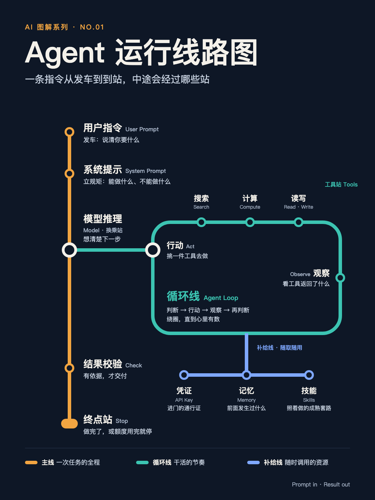

# Agent 运行线路图

一次 Agent 任务有三条线：主线从指令走到交付，循环线把工具结果送回模型做下一轮判断，补给线提供按需使用的资源。这是理解运行机制的示意图，不是所有 Agent 都必须走的固定流程。

## 地铁版：模型推理是换乘站

- **主线**：用户给出任务，系统提示设定规则，模型决定下一步；交付前校验结果，完成或达到上限后停止。
- **循环线**：判断 → 行动（例如搜索、计算、读写）→ 观察工具返回结果 → 回到模型，再判断。
- **补给线**：凭证提供访问权限，记忆补充上下文，技能提供可复用的做法。它们按需使用，不是每轮都要经过的站点。

## 古籍版：从右至左读「智能體運行要略」

想看循环如何落到代码里，可以接着读[动手实现一个 Coding Agent](../p2-agent-basics/02-coding-agent.md)。
